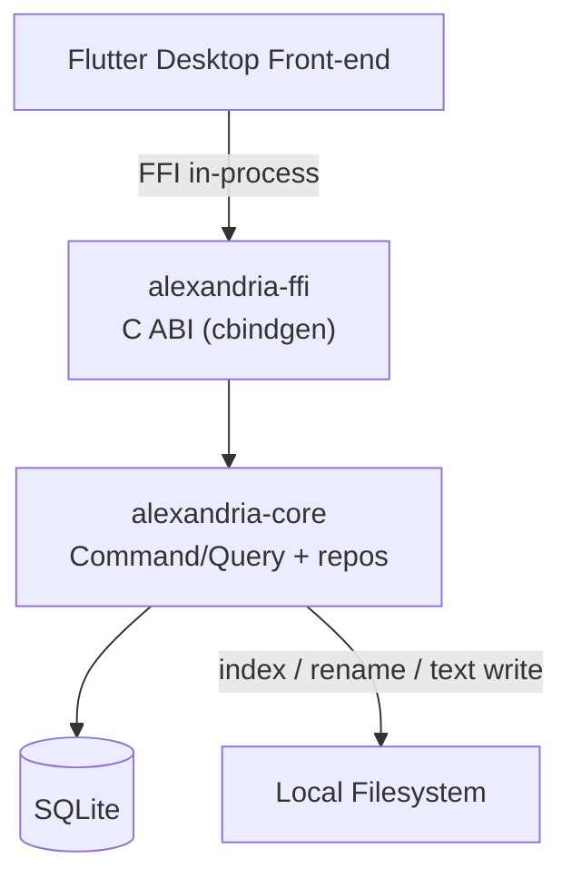

# Alexandria API

A fast, type-aware personal library manager back-end written in Rust. The owner
adds folders as **libraries**; Alexandria indexes every file in them it can read
— movies and series, music and other audio, HTML pages, Markdown and text files,
PDFs and e-books, comic books, and images — keeps each library's folder
structure exactly as it is on disk, and lets a client browse that tree and open,
read, or play what is in it, without re-encoding, duplicating, or relocating
anything. A folder that is not a library is invisible to Alexandria. Browser
bookmarks are kept alongside. Audio is played as files, not managed as music:
playlists, play history and lookups belong to Orpheus, a separate project. The
domain logic lives in a reusable Rust core library, used through its C ABI: the
Flutter desktop front-end loads it and calls it in process.

> Single-user and local: the core runs on the owner's machine, for the person at
> it, with no server and no login. Metadata + path only, never the bytes. No
> complex media editing. Two-phase soft/hard deletion.

## Project status

Issues are tracked in the [Alexandria API project board](https://github.com/users/artur-rios/projects/8)
and grouped into [milestones](https://github.com/artur-rios/alexandria-api/milestones)
that mirror the feature groups in
[System Requirements Document §9.1](docs/requirements/System%20Requirements%20Document.md).
Each row below links to its issue; GitHub renders the issue's `#` reference with
its open/closed state, so the tables stay in sync with the board automatically.

| Milestone | Scope | Progress |
| --- | --- | :---: |
| [F-00 Foundation & operations](https://github.com/artur-rios/alexandria-api/milestone/1) | Scaffold, config, migrations, settings | 2 / 2 |
| [F-01 File indexing](https://github.com/artur-rios/alexandria-api/milestone/2) | UC-01 … UC-02, UC-42, UC-48 | 3 / 3 |
| [F-02 Catalog browsing & metadata editing](https://github.com/artur-rios/alexandria-api/milestone/3) | UC-03 … UC-04 | 2 / 2 |
| [F-03 Renaming & lifecycle management](https://github.com/artur-rios/alexandria-api/milestone/4) | UC-05 … UC-09 | 5 / 5 |
| [F-04 Text file content editing](https://github.com/artur-rios/alexandria-api/milestone/5) | UC-32 … UC-33 | 2 / 2 |
| [F-05 Collections](https://github.com/artur-rios/alexandria-api/milestone/6) | UC-10 … UC-14, UC-46 | 6 / 6 |
| [F-06 Bookmarks](https://github.com/artur-rios/alexandria-api/milestone/7) | UC-15 … UC-19 | 5 / 5 |
| [F-07 Watchlists](https://github.com/artur-rios/alexandria-api/milestone/8) | UC-20 … UC-25 | 6 / 6 |
| [F-08 Reading lists](https://github.com/artur-rios/alexandria-api/milestone/9) | UC-26 … UC-31 | 6 / 6 |
| [F-10 Media playback](https://github.com/artur-rios/alexandria-api/milestone/11) | UC-38 … UC-40 | 3 / 3 |
| F-12 Libraries | UC-51, UC-53 … UC-56, UC-01 | 5 / 5 |
| **Total** | | **45 / 45** |

The last one carries no milestone link and no issue number, and that is
honest rather than an omission: it was built from a design document in
`docs/superpowers/specs/` rather than from the issue-per-use-case backlog the
first ten follow. What it is not is undocumented — it has its
requirements in
[System Requirements Document §3](docs/requirements/System%20Requirements%20Document.md)
and its FFI calls in §5, which is what the tables below trace against.

F-09, pluggable authentication, is gone, and so is the health check (UC-37):
the core only runs locally for the person at the machine, so its login and its
HTTP server were removed. Their use cases are recorded as withdrawn in the
[Use Case Specification Document](docs/requirements/Use%20Case%20Specification%20Document.md).

### F-00 — Foundation & operations

Workspace scaffold, configuration, migrations, and logging.

| Issue | Use case | Status | Title | Requirements |
| --- | --- | :---: | --- | --- |
| [#1](https://github.com/artur-rios/alexandria-api/issues/1) | — | &#9745; | Scaffold and initial infrastructure | IR-01 … IR-06 |
| [#108](https://github.com/artur-rios/alexandria-api/issues/108) | UC-47 | &#9745; | Report the retention window | FR-FC-30 |

### F-01 — File indexing

Discover the files in each library's folder, classify them by type, record the stat pair every
directory entry already carries, and keep the catalog current — with each run
observable, pausable, resumable, and cancellable while it walks.

| Issue | Use case | Status | Title | Requirements |
| --- | --- | :---: | --- | --- |
| [#2](https://github.com/artur-rios/alexandria-api/issues/2) | UC-01 | &#9745; | Index a library | FR-FC-01 … FR-FC-09 |
| [#3](https://github.com/artur-rios/alexandria-api/issues/3) | UC-02 | &#9745; | Re-index and refresh the catalog | FR-FC-08, FR-FC-10, FR-FC-11 |
| [#99](https://github.com/artur-rios/alexandria-api/issues/99) | UC-42 | &#9745; | Query an index or refresh run | FR-FC-27, FR-FC-28, FR-FC-29, FR-FC-35 |
| — | UC-48 | &#9745; | Pause, resume, or cancel an index run | FR-FC-27, FR-FC-29, FR-FC-31 … FR-FC-34 |

### F-02 — Catalog browsing & metadata editing

Read the catalog and edit type-specific metadata.

| Issue | Use case | Status | Title | Requirements |
| --- | --- | :---: | --- | --- |
| [#4](https://github.com/artur-rios/alexandria-api/issues/4) | UC-03 | &#9745; | Browse and view file metadata | FR-FC-12, FR-FC-13 |
| [#5](https://github.com/artur-rios/alexandria-api/issues/5) | UC-04 | &#9745; | Edit file metadata | FR-FC-15 … FR-FC-18 |

### F-03 — Renaming & lifecycle management

Rename on disk, plus the two-phase soft-delete → restore → purge lifecycle.

| Issue | Use case | Status | Title | Requirements |
| --- | --- | :---: | --- | --- |
| [#6](https://github.com/artur-rios/alexandria-api/issues/6) | UC-05 | &#9745; | Rename a file | FR-FC-19 |
| [#7](https://github.com/artur-rios/alexandria-api/issues/7) | UC-06 | &#9745; | Soft-delete a file | FR-FC-20 |
| [#8](https://github.com/artur-rios/alexandria-api/issues/8) | UC-07 | &#9745; | Restore a soft-deleted file | FR-FC-21 |
| [#9](https://github.com/artur-rios/alexandria-api/issues/9) | UC-08 | &#9745; | Hard-purge a file record | FR-FC-22, NFR-07 |
| [#10](https://github.com/artur-rios/alexandria-api/issues/10) | UC-09 | &#9745; | Purge a file on disk | FR-FC-23 |

### F-04 — Text file content editing

Read and write TextFile content on disk, refreshing the content hash.

| Issue | Use case | Status | Title | Requirements |
| --- | --- | :---: | --- | --- |
| [#33](https://github.com/artur-rios/alexandria-api/issues/33) | UC-32 | &#9745; | Read text file content | FR-TX-01 |
| [#34](https://github.com/artur-rios/alexandria-api/issues/34) | UC-33 | &#9745; | Edit text file content | FR-TX-02, FR-TX-03 |

### F-05 — Collections

Flat file and bookmark groupings; deleting a collection preserves its items.

| Issue | Use case | Status | Title | Requirements |
| --- | --- | :---: | --- | --- |
| [#11](https://github.com/artur-rios/alexandria-api/issues/11) | UC-10 | &#9745; | Create a collection | FR-CO-01, FR-CO-02 |
| [#12](https://github.com/artur-rios/alexandria-api/issues/12) | UC-11 | &#9745; | Rename a collection | FR-CO-03 |
| [#13](https://github.com/artur-rios/alexandria-api/issues/13) | UC-12 | &#9745; | Delete a collection | FR-CO-04 |
| [#14](https://github.com/artur-rios/alexandria-api/issues/14) | UC-13 | &#9745; | Add items to a collection | FR-CO-05 |
| [#15](https://github.com/artur-rios/alexandria-api/issues/15) | UC-14 | &#9745; | Remove and list items in a collection | FR-CO-06, FR-CO-07, FR-FC-12 |
| [#106](https://github.com/artur-rios/alexandria-api/issues/106) | UC-46 | &#9745; | Browse collections | FR-CO-08 |

### F-06 — Bookmarks

Browser bookmarks, with the same two-phase deletion model as files.

| Issue | Use case | Status | Title | Requirements |
| --- | --- | :---: | --- | --- |
| [#16](https://github.com/artur-rios/alexandria-api/issues/16) | UC-15 | &#9745; | Create a bookmark | FR-BM-01 |
| [#17](https://github.com/artur-rios/alexandria-api/issues/17) | UC-16 | &#9745; | Update a bookmark | FR-BM-02 |
| [#18](https://github.com/artur-rios/alexandria-api/issues/18) | UC-17 | &#9745; | Browse bookmarks | FR-BM-06 |
| [#19](https://github.com/artur-rios/alexandria-api/issues/19) | UC-18 | &#9745; | Soft-delete and restore a bookmark | FR-BM-03, FR-BM-05 |
| [#20](https://github.com/artur-rios/alexandria-api/issues/20) | UC-19 | &#9745; | Hard-purge a bookmark | FR-BM-04 |

### F-07 — Watchlists

Video consumption tracking, per episode for series.

| Issue | Use case | Status | Title | Requirements |
| --- | --- | :---: | --- | --- |
| [#21](https://github.com/artur-rios/alexandria-api/issues/21) | UC-20 | &#9745; | Create a watchlist | FR-WL-01 |
| [#22](https://github.com/artur-rios/alexandria-api/issues/22) | UC-21 | &#9745; | Browse watchlists and progress | FR-WL-08 |
| [#23](https://github.com/artur-rios/alexandria-api/issues/23) | UC-22 | &#9745; | Add a video to a watchlist | FR-WL-02, FR-WL-03 |
| [#24](https://github.com/artur-rios/alexandria-api/issues/24) | UC-23 | &#9745; | Update watch progress | FR-WL-04, FR-WL-05 |
| [#25](https://github.com/artur-rios/alexandria-api/issues/25) | UC-24 | &#9745; | Remove a video from a watchlist | FR-WL-06 |
| [#26](https://github.com/artur-rios/alexandria-api/issues/26) | UC-25 | &#9745; | Delete a watchlist | FR-WL-07 |

### F-08 — Reading lists

Book and comic consumption tracking, per issue for comic series.

| Issue | Use case | Status | Title | Requirements |
| --- | --- | :---: | --- | --- |
| [#27](https://github.com/artur-rios/alexandria-api/issues/27) | UC-26 | &#9745; | Create a reading list | FR-RL-01 |
| [#28](https://github.com/artur-rios/alexandria-api/issues/28) | UC-27 | &#9745; | Browse reading lists and progress | FR-RL-08 |
| [#29](https://github.com/artur-rios/alexandria-api/issues/29) | UC-28 | &#9745; | Add an item to a reading list | FR-RL-02, FR-RL-03 |
| [#30](https://github.com/artur-rios/alexandria-api/issues/30) | UC-29 | &#9745; | Update reading progress | FR-RL-04, FR-RL-05 |
| [#31](https://github.com/artur-rios/alexandria-api/issues/31) | UC-30 | &#9745; | Remove an item from a reading list | FR-RL-06 |
| [#32](https://github.com/artur-rios/alexandria-api/issues/32) | UC-31 | &#9745; | Delete a reading list | FR-RL-07 |

### F-10 — Media playback

Hand the front-end the path of a file to play, plus comic pages and thumbnails.

| Issue | Use case | Status | Title | Requirements |
| --- | --- | :---: | --- | --- |
| [#90](https://github.com/artur-rios/alexandria-api/issues/90) | UC-38 | &#9745; | Stream file content | FR-MP-01, FR-MP-03, FR-MP-06 |
| [#91](https://github.com/artur-rios/alexandria-api/issues/91) | UC-39 | &#9745; | Read a comic book page | FR-MP-03, FR-MP-04, FR-MP-06 |
| [#92](https://github.com/artur-rios/alexandria-api/issues/92) | UC-40 | &#9745; | Get a file thumbnail | FR-MP-05, FR-MP-06 |

### F-12 — Libraries

The way into Alexandria, and the only one: a folder added as a library is
indexed, browsed as its own tree, re-indexed on its own, corrected when it
moves, renamed, pinned or marked as a favorite, and removed with its catalog
records. Every other feature works on the files libraries hold, and the
catalog's totals count them.

| Issue | Use case | Status | Title | Requirements |
| --- | --- | :---: | --- | --- |
| — | UC-51 | &#9745; | Add a library | FR-FC-36 … FR-FC-42 |
| — | UC-53 | &#9745; | Pin a library | FR-FC-44 |
| — | UC-54 | &#9745; | Mark a library as a favorite | FR-FC-45 |
| — | UC-55 | &#9745; | Rename a library | FR-FC-46 |
| — | UC-56 | &#9745; | Report catalog statistics | FR-FC-47 |

To update the tables: when an issue closes, flip its marker from **&#9744;** to
**&#9745;** and bump the milestone's progress count. The issue number references
are live GitHub links, so they also reflect state via the issue badge.

## Architecture

Two crates: the core library holds every decision, and a thin C ABI carries it
to the Flutter desktop front-end, which calls it in process:



The domain follows SOLID with a Command/Query (CQRS-style) baseline. Repository
**traits** in `alexandria-core` are what make the handlers unit-testable;
`alexandria-ffi` is a thin transport layer over them. There is no login: the
core only runs locally, for the person at the machine.

## Running

The core is built from source. It needs Rust **1.94** or newer and, because
`alexandria-core` links ffmpeg for video metadata extraction, the ffmpeg C
development libraries (any version from 3.0 to 9.0) and `clang` installed
before the workspace will build. The per-platform install — including Windows,
which takes a few deliberate steps — is in
[CONTRIBUTING.md](./CONTRIBUTING.md#prerequisites).

```bash
cargo build --release -p alexandria-ffi
```

That builds the dynamic library and regenerates its C header
(`crates/alexandria-ffi/src/header.h`). The desktop front-end links it in
process, and its packages carry it; nothing here listens on a port.

Configuration is read from `config.toml` (or the file `ALEXANDRIA_CONFIG`
names) when the front-end calls `alexandria_index_init`, with every key
overridable through an environment variable named
`ALEXANDRIA_<SECTION>_<KEY>` — `ALEXANDRIA_DATABASE_PATH`,
`ALEXANDRIA_LOGGING_LEVEL`. The rule has no exceptions. See
[`config.toml.example`](config.toml.example) for the full list (SQLite path,
filesystem root — which bounds what indexing, library moves, and file access
may reach — indexing concurrency, soft-delete retention, log level, thumbnail
cache). Unknown keys and tables are ignored, so a `config.toml` that still has
the old `[auth]` or `[http]` tables keeps loading.

> One configuration change fails quietly rather than loudly. The log level's
> override is `ALEXANDRIA_LOGGING_LEVEL`; `ALEXANDRIA_LOG_LEVEL` is no longer
> read, so a shell profile still exporting it leaves the level at its default.

`alexandria_index_init` applies the migrations itself. To prepare a database
out-of-band instead:

```bash
sqlx migrate run --source crates/alexandria-core/migrations \
  --database-url "sqlite:${ALEXANDRIA_DATABASE_PATH:-alexandria.sqlite}?mode=rwc"
```

Two notes on that URL, verified against sqlx-cli 0.9.0: `?mode=rwc` is required
or the CLI refuses to create a database that does not exist yet, and the scheme
takes a single colon with no `//`. The `sqlite://` form fails on Windows
absolute paths, where the drive letter parses as a URL authority.

### Upgrading

**Alexandria is pre-release, and an upgrade can require you to delete your
database.** Until the first packaged release, the two baseline migrations
(`00000000000001_catalog.sql` and `00000000000011_catalog_runs.sql`) are
amended in place rather than corrected by a new migration — see
[Operations & Infrastructure Document §2.5](docs/requirements/Operations%20&%20Infrastructure%20Document.md).
sqlx checksums a migration's file content, so an amended baseline no longer
matches what your database recorded, and migrations run before the core answers
any call (IR-05). The upgrade therefore fails at initialization rather than
misbehaving later:

```
database migration error: migration 1 was previously applied but has been modified
```

The fix is to delete the database file and let it rebuild:

```bash
rm "${ALEXANDRIA_DATABASE_PATH:-alexandria.sqlite}"
```

Then start the app and add your folders again as libraries
(`alexandria_library_register`), which indexes them. The catalog is derived from the
files on disk, so re-indexing restores it — but
anything the catalog holds that is *not* derived from disk is lost: edited
metadata, collections, bookmarks, watchlists, reading lists, watch and reading
progress. Export or note whatever you need first.

#### Breaking changes so far

| Change | Effect |
| --- | --- |
| `size_bytes`/`mtime` change detection replaced full-file hashing (FR-FC-09), and the run record gained progress, pause, priority, and segment columns (UC-42) | Both baselines amended. Delete the database and re-index. |
| Music and audio removed (0.5.0): Alexandria no longer catalogs audio files, and music now lives in Orpheus, a separate project. Migration 25 deletes the stored music — audio files, tags, lyrics, artist photography records, play history, playlists, and track energy — and removes `audio` from any recorded index run; migration 26 deletes the run failures recorded on audio files | No database deletion needed; the migration runs on startup. Files on disk are never touched. The `[metadata]` config section is ignored if still present. |
| Libraries are the only way in (0.6.0): files enter the catalog only by being inside a library. `POST /v1/index`, `alexandria_index_start`, the `types` scope and the `includeLibraries` listing flag are gone; adding a library (`POST /v1/libraries`) indexes it, and `POST /v1/libraries/{uuid}/index` re-indexes it. Migration 28 **deletes every catalog record outside a library** — the files, their progress and collection membership, and the index runs over roots no library holds. Audio is a catalog type again, as playable files (no playlists, history or lookups) | **Back up your database before the first start on 0.6.0** if you want to keep watch or reading progress and collection membership on files outside libraries. Then add your folders as libraries. Files on disk are never touched. |
| No authentication and no HTTP server: authentication in all three modes, the `alexandria-http` server, the `token` parameter on every FFI call and `*_ERR_UNAUTHORIZED` (code 2, retired) are removed. Migration 30 deletes the stored local-login credential, the sessions and the recovery codes, and adds the `pinned` and `favorite` flags to every library, both off | No database deletion needed; the migration runs when the core is initialized. Nothing but the authentication records is lost, and files on disk are never touched. A `config.toml` that still has `[auth]` or `[http]` tables keeps loading; they are ignored. |

### Media playback

There is no stream: `alexandria_file_playback_source` returns the file's path,
MIME type and size, and the client opens the file directly, which is what the
desktop front-end's player (media_kit, over libmpv) does.
`alexandria_comic_page` and `alexandria_file_thumbnail` return a comic page and
a thumbnail base64 in their JSON answer.

## Documentation

The full specification set lives under [`docs/`](docs/):

- Informal: [`docs/initial/`](docs/initial/) — Project Overview, Technology Stack, Workflow, Business Rules.
- Formal: [`docs/requirements/`](docs/requirements/) — Vision, System Requirements, Use Case Specification, Development Workflow, Testing Specification, Operations & Infrastructure, Technology Stack.
- Behavior: [`docs/System Behavior Document.md`](docs/System%20Behavior%20Document.md) — how the running system actually behaves, with diagrams: initialization, the error model, the indexing and run-control machinery, library flags and totals, playback, and the deletion lifecycle.

The requirements documents say what the system *shall* do and are the source of
truth the issues trace into; the behavior document says what it *does*. Where
the two disagree, one of them is a bug.

## Changelog

Notable changes are recorded in [CHANGELOG.md](./CHANGELOG.md). No release has
been tagged yet.

## Contributing

The repository layout, building from source, running the tests, migrations,
the branching model and the versioning policy are described in
[CONTRIBUTING.md](./CONTRIBUTING.md).

The GitHub repository is a read-only mirror for the real, open-source code of alexandria-api. Its home is Forgejo, at
https://git.techcraftsmen.net/artur-rios/alexandria-api. If you want to contribute, e-mail me at arturdev@duck.com.

## Legal details

Copyright (c) 2026 Artur Rios.

This project is licensed under the [Artur Rios Attribution License](LICENSE).
It is free and open source: you may view, use, fork, modify, and extend it,
provided you credit the author, Artur Rios, with a link to
[artur-rios.tech](https://artur-rios.tech) or
[github.com/artur-rios](https://github.com/artur-rios). The desktop front end
([alexandria-ui](https://github.com/artur-rios/alexandria-ui)) is under the same
licence.

### Bundled libraries

The Attribution License covers this repository's source code. The third-party
libraries the program links are not part of it: each keeps its own licence.

The core links ffmpeg, and the desktop front end links this core in process and
plays video through libmpv. Its Linux release packages are meant to be plug and
play: unpack one on a machine with a desktop and it runs, with nothing to
install first. That means carrying those libraries rather than asking the
user's distribution for them, and libmpv is copyleft from every distribution
that ships it, as are the x264 and x265 encoders ffmpeg links whether or not
anything ever encodes with them.

Each bundled library keeps its own licence: the packages carry those texts in
`lib/licenses`, and the copyleft ones are listed in `lib/licenses/COPYLEFT.tsv`.
A Linux binary package that bundles them is distributed as a combined work
subject to those libraries' terms, which means the GPL, version 3. The Windows
packages carry an LGPL build of ffmpeg and no mpv.
