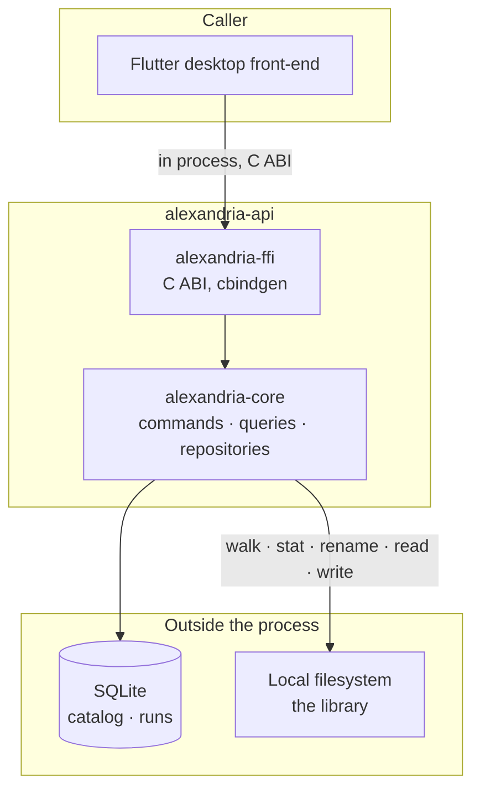
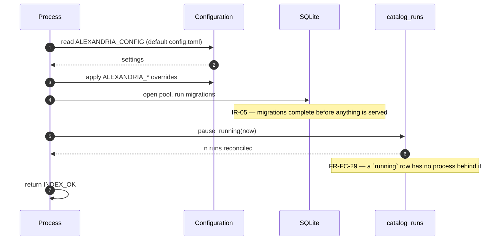
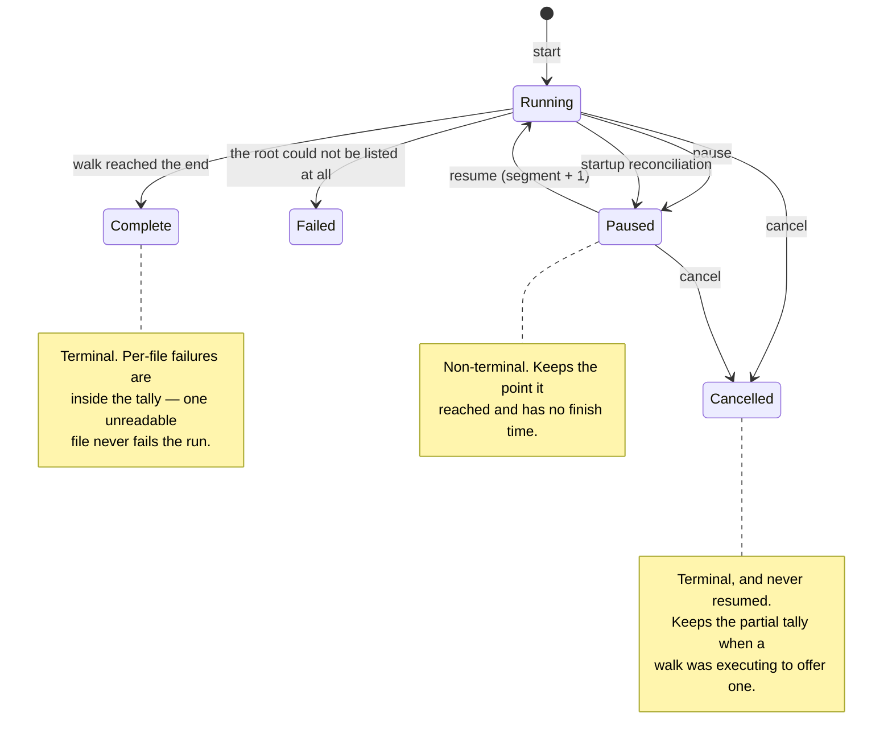
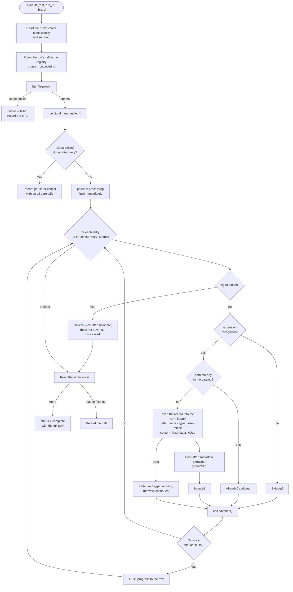
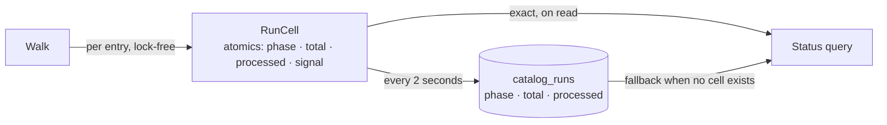
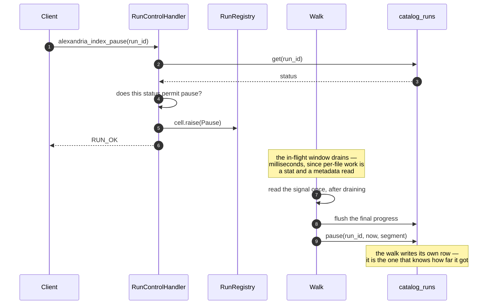
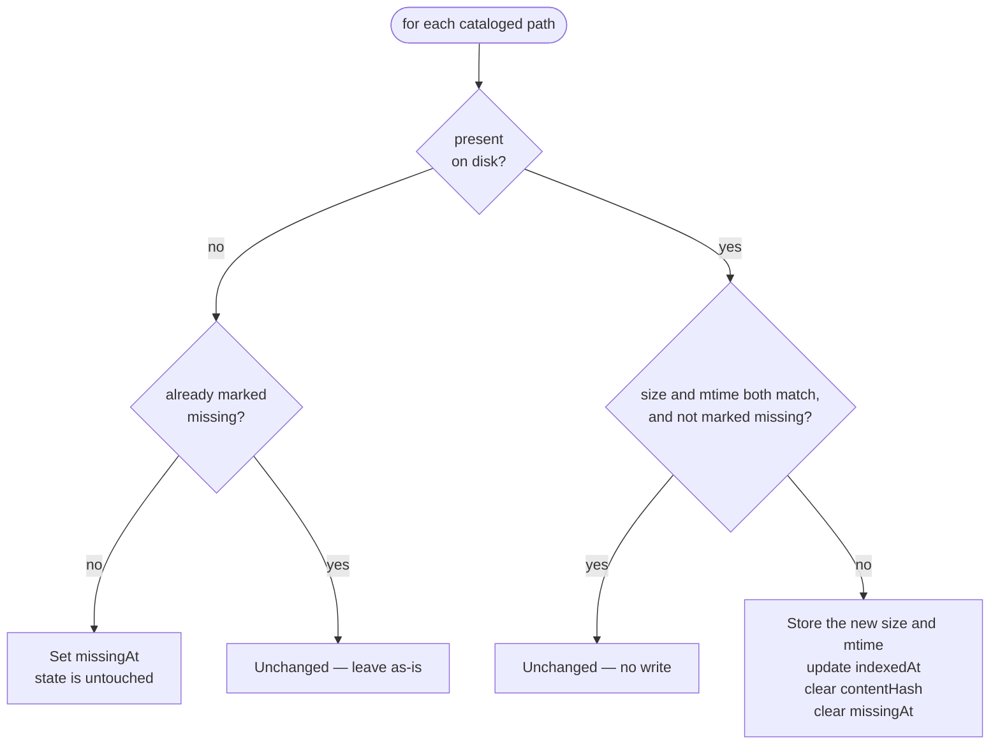
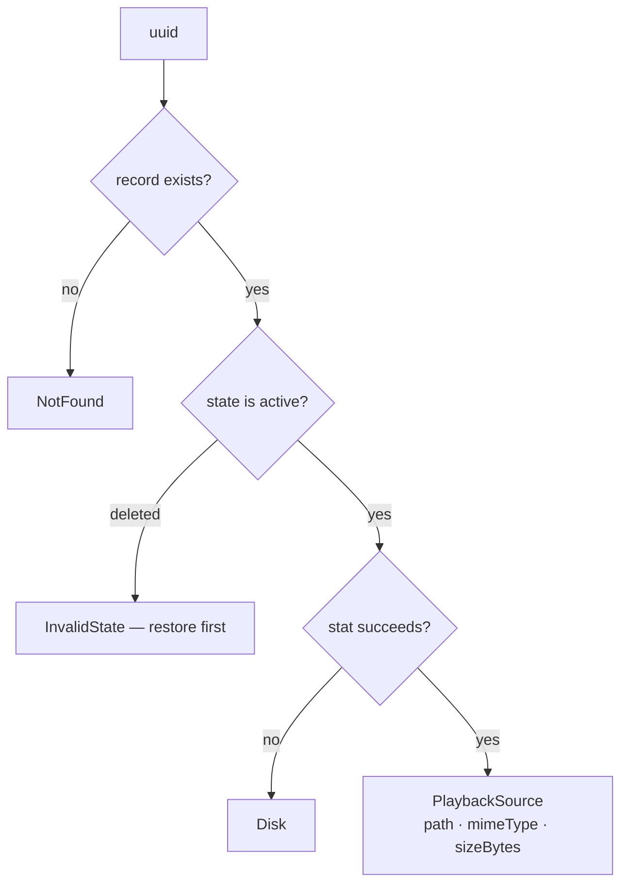
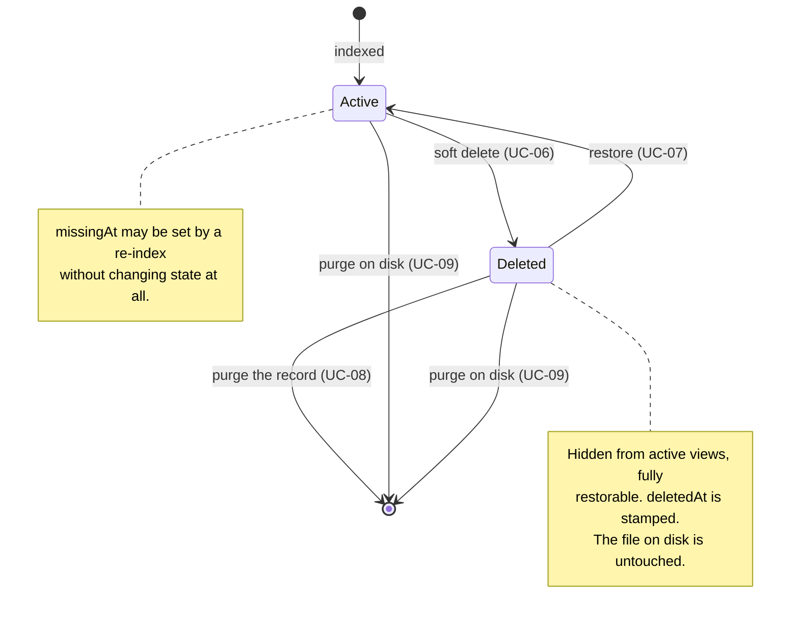

# System Behavior Document — Alexandria

## 1. Introduction

### 1.1 Purpose

The requirements documents say what Alexandria **shall** do. This one says what
it **does**: the order things happen in, the state each operation moves through,
what is written where, and which failures the system absorbs rather than
reports.

It is written for someone who has to reason about the running system — porting a
client, diagnosing a scan that stopped, or deciding whether a change is safe.

### 1.2 How it relates to the other documents

| Document | Answers |
| --- | --- |
| [Vision Document](requirements/Vision%20Document.md) | Why the system exists |
| [System Requirements Document](requirements/System%20Requirements%20Document.md) | What it shall do (`FR-*`, `NFR-*`) |
| [Use Case Specification Document](requirements/Use%20Case%20Specification%20Document.md) | What each operation's flows and alternatives are (`UC-*`, `AF-*`) |
| **This document** | How the implementation actually behaves |
| [Operations & Infrastructure Document](requirements/Operations%20%26%20Infrastructure%20Document.md) | How it is configured, logged, and deployed (`IR-*`) |

Where this document and a requirements document disagree, one of them is a bug.
Requirement identifiers are cited throughout so the two can be checked against
each other.

### 1.3 Scope

Everything the core does at run time, with two subsystems covered in depth
because they are the ones with real machinery behind them: **indexing** (§5) and
**playback** (§6).

---

## 2. Shape of the system

Two crates. One core library holds every decision; a thin C ABI carries it to
the one caller and holds none of its own.



The desktop application loads the core in process: one process, no network
hop, no second thing to install. There is no server and no login. The core only
runs locally, for the person at the machine, so the HTTP server and the
authentication it guarded are removed (`FR-FC-24`, `NFR-09` and every `FR-AU`
requirement).

### 2.1 Why both surfaces answer alike

**Removed (the core only runs locally for the person at the machine)**

There is one surface. Every operation is still a **handler** in
`alexandria-core`, generic over its collaborators (repositories, filesystem,
clock), and `alexandria-ffi` maps a C call onto that handler and a
`DomainError` onto the call family's integer code. The FFI holds no decision of
its own.

Byte transfer is the one thing the C ABI cannot do (`FR-MP-06`):
`alexandria_file_playback_source` returns a descriptor and the client opens the
file itself. See §6.4.

---

## 3. Startup

`alexandria_index_init` runs this sequence before the core answers anything else.



### 3.1 Configuration

Read once from `config.toml`, then overridden per key from the environment. The
naming rule is `ALEXANDRIA_<SECTION>_<KEY>` — `ALEXANDRIA_DATABASE_PATH`,
`ALEXANDRIA_LOGGING_LEVEL` — and every key follows it, with no exceptions.

Unknown keys and tables are ignored, so a stale key left in a config file — or
the `[auth]` and `[http]` tables an older core read — is inert rather than
fatal. Every key is listed in
[`config.toml.example`](../config.toml.example).

### 3.2 Migrations

Applied by `alexandria_index_init` before the core answers any other call
(`IR-05`). While the project is pre-release the two baseline migrations
are **amended in place** rather than corrected by a new migration, so an
existing database can fail initialization with:

```
database migration error: migration 1 was previously applied but has been modified
```

That is deliberate and the recovery is to delete the database and re-index —
see the README's *Upgrading* section for what is and is not recoverable.

### 3.3 Run reconciliation

Runs execute in-process. A row still marked `running` at startup therefore
provably has no task behind it, so it is recorded `paused` (`FR-FC-29`) and
offered for resume. **Nothing resumes by itself.** A failure here is logged and
startup continues: the catalog is fully usable, and the stale rows are
reconciled on the next boot.

---

## 4. Every call

### 4.1 The authorization gate

**Removed (the core only runs locally for the person at the machine)**

There is no gate. Every call acts: a handler that once checked a session or a
token before acting simply acts. No call takes a `token`.

### 4.2 Credential extraction

**Removed (the core only runs locally for the person at the machine)**

### 4.3 The error model

One `DomainError` per failure, mapped to the calling family's integer code.
On a failure the result's `json` is NULL: there is no error body.

| `DomainError` | FFI code | Meaning |
| --- | --- | --- |
| `NotFound` | `*_ERR_NOT_FOUND` | No entity by that id |
| `InvalidInput` | `*_ERR_INVALID_INPUT` (1) | Input the domain refuses, or an argument that does not parse |
| `InvalidState` | `*_ERR_INVALID_STATE` | Illegal transition for the entity's current state |
| `Conflict` | `*_ERR_CONFLICT` (index, library) | Collides with state that already exists |
| `Disk` | `*_ERR_DISK` (file, playback) | A filesystem operation failed; nothing was committed |
| `Integrity` | `*_ERR_INTEGRITY` (file) | A write's post-write verification failed |
| any other | `*_ERR_OTHER` | A database, migration, configuration or internal failure, or a panic caught at the boundary |

A call made before `alexandria_index_init` answers `*_ERR_NOT_INITIALIZED` (3).
A family without a code for a variant answers `*_ERR_OTHER`. Code 2 was
`*_ERR_UNAUTHORIZED` and is retired in every family, never reused, so a client
built against an older core cannot read a new failure as it.

---

## 5. Indexing

The largest subsystem, and the one whose behavior is least guessable from the
FFI calls.

### 5.1 What a scan costs, and why

Indexing **reads no file bytes to identify a file** (`FR-FC-09`). Per-file work
is one `stat` plus, at first index only, a read of the file's embedded
metadata. Re-index is one `stat` and nothing else.

This is the single most important behavioral fact about the system, because it
inverts the cost model:

| | Cost scales with | A 418 GB library |
| --- | --- | --- |
| Hashing every file | total **size** | tens of minutes |
| Stat pair (current) | file **count** | proportional to how many files, not how big |

The change signal is the **stat pair** — `size_bytes` and `mtime`, both taken
from the directory entry the walk already produced (`FR-FC-10`). A difference in
either is a change.

`content_hash` is therefore `NULL` for essentially every file. Nothing on the
scan path writes it; the only writer is the post-write verification of a text
edit (`FR-TX-03`), and a re-index **clears** it on a changed file so a hash can
never outlive the bytes it described.

### 5.2 The run record

Every index and re-index is a **run**, recorded in `catalog_runs` and addressable
by the id `start` returns (`FR-FC-27`).

| Column group | Columns | Written by |
| --- | --- | --- |
| Identity | `id`, `kind`, `root`, `library_id`, `started_at` | `start` |
| Lifecycle | `status`, `finished_at`, `error` | terminal writes and the control verbs |
| Index counts | `scanned`, `indexed`, `skipped`, `already_cataloged`, `failed` | `finish` / `cancel` |
| Re-index counts | `refreshed`, `marked_missing`, `unchanged`, `failed` | `finish` / `cancel` |
| Progress | `phase`, `total`, `processed` | periodic flush from the in-memory cell |
| Pause accounting | `paused_at`, `paused_millis` | `pause` / `resume` |
| Pacing | `concurrency` | `start`, and `resume` when it re-paces |
| Race guard | `segment` | `resume` only |

`skipped` (a file of a type Alexandria cannot read — §5.13) and `already_cataloged` (a path the catalog already held) are counted
**apart**. Folding them together made a resumed run
report every entry an earlier segment had cataloged as a skip — a tally that
misdescribes what happened.

### 5.3 Run states



`running` and `paused` are the non-terminal states; a request for a transition
the current state does not permit is refused as a conflict rather than silently
accepted (`FR-FC-32`, `FR-FC-33`, `FR-FC-34`).

### 5.4 Start and execute are separate

A scan takes minutes. The call that begins one returns in milliseconds.

```mermaid
sequenceDiagram
    autonumber
    participant CL as Client
    participant T as FFI
    participant H as IndexHandler
    participant R as catalog_runs
    participant W as Walk task

    CL->>T: alexandria_library_register({name, rootPath, priority})
    T->>H: register → start(library)
    H->>H: folder inside filesystem.root? (FR-FC-26)
    H->>H: overlaps no library?
    H->>R: insert library
    H->>H: folder exists?
    H->>R: insert run (running, library, concurrency from priority)
    Note over R: FR-FC-27 — the run opens only after<br/>validation; a run that cannot open<br/>removes the library again
    H-->>T: library + run id
    T->>W: spawn execute(root, run_id, library)
    T-->>CL: LIBRARY_OK {…library, runId}
    W->>W: walk, classify, stat, persist
```

Re-indexing a library (`alexandria_library_index_start`) takes the same path
from "insert run" on, after refusing a library that already has a `running` or
`paused` run (`FR-FC-43`), and answers `INDEX_OK` with the run id. A library's folder
is the only root ever walked: there is no indexing a folder that is not a
library.

Validation happens before the run opens, so a rejected call never leaves a
run record behind. The run id is handed back only once a record exists to query — the one
write in this handler whose failure is *not* swallowed, because a caller must
never receive an id it can never look up.

### 5.5 The library-root bound

When `filesystem.root` is set, a library's folder must be that path or a
descendant (`FR-FC-26`), checked when it is added and again when it is indexed. The same check, one function (`LibraryRoot::contains`), also
bounds the two other ways a path reaches the disk:

- **Correcting a library's root** (UC-51). A correction rewrites every stored
  path under the library without walking the disk, so without the bound it
  would be the way around it: add `<root>/x` holding `notes.txt`, correct it
  to `/home/someone`, and the stream serves
  `/home/someone/notes.txt`. The rejection is the index's, word for word.
- **Serving or changing a cataloged file** — stream, comic page, thumbnail,
  text read and edit, rename, purge-on-disk. A record can still point outside:
  catalogued before the bound was configured, corrected before corrections
  were bounded, or reached through a symbolic link swapped in since. Such a
  record is refused with `file is outside the configured library root`.
  Purging only the record (UC-08) never touches the disk, so it stays the way
  to drop one.

Both sides are **canonicalized** before comparison, which is what
holds the bound against `<root>/../../etc`, against `<root>` vs `<root>/` vs
`<root>/.`, and against a symlinked root. The comparison is `Path::starts_with`,
matching whole components — a string prefix test would let `/library-evil` past a
`/library` bound.

A library may be corrected to a folder that does not exist yet — a drive that is
not plugged in — so the path is not required to exist. It is resolved through
its **longest existing ancestor**, which is canonicalized, and the remaining
segments are normalised lexically (`..` pops, `.` drops). Nothing below a
missing folder can be a symbolic link, so that is exact. A segment that exists
but cannot be resolved — a dangling symbolic link, a folder the core may not
look into, a link loop — makes the whole path count as outside.

Two distinct rejections, deliberately:

| Condition | Message |
| --- | --- |
| The requested root — to index, or to correct a library to — is genuinely outside | `root path is outside the configured library root` |
| A cataloged file to serve or change resolves outside | `file is outside the configured library root` |
| The configured `filesystem.root` itself cannot be resolved | `the server's configured library root could not be resolved; contact the operator` |

The last is a misconfiguration, not a caller error, and every bounded operation is **refused**
rather than degraded to unconstrained. A security bound that disappears when its
configuration is wrong is worse than no bound, because the operator believes it
is there. Neither message names the configured path.

When `filesystem.root` is unset the bound is off entirely: any readable root is
indexed, a library may be corrected to any folder, and any cataloged file is
served — the constraint is opt-in by configuration, so a deployment without it
behaves exactly as before. One that sets it after cataloging files elsewhere
will find those files refused until it re-indexes them under the root or
purges their records. Re-index takes no root and is unaffected.

### 5.6 The walk



Points worth stating plainly:

- **One unreadable file never abandons the walk.** A failure concerning one
  specific file is counted in `failed`, logged at `warn`, and the walk
  continues. Only a failure to list the root at all makes the run `failed`.
- **Order is unspecified, counts are not.** Up to `concurrency` entries are in
  flight, so completion order varies; each entry contributes exactly one
  outcome regardless of when it lands.
- **A duplicate path cannot corrupt the catalog.** `list_files` cannot produce a
  path twice, and the `files.path` unique constraint turns any duplicate into
  that entry's own `failed` rather than a second record.

### 5.7 Concurrency and priority

A run is started at `normal` or `low` priority (`FR-FC-31`), resolved against
configuration into a width:

| Priority | Setting | Default |
| --- | --- | :---: |
| `normal` | `indexing.concurrency` | 4 |
| `low` | `indexing.low_priority_concurrency` | 1 |

Zero is clamped to 1 for both — a stream buffered zero deep makes no progress.

An absent or unrecognised priority is **`normal`** rather than a rejected call,
including a value that is not a string at all.

The width is read from **the run's own row**, not from a field on the handler.
`IndexHandler` is built once at startup and serves both fresh and resumed runs,
so a field could not tell the two apart; the row is what lets a resumed run
continue at the width it was last set to. Three outcomes on that read:

| Row says | Behavior |
| --- | --- |
| a width | use it |
| no width (run predates the column, or `execute` was called without `start`) | fall back to `indexing.concurrency`, silently |
| the read failed | fall back to `indexing.concurrency`, logged at `warn` |

A transient store error must not abort a scan that could run perfectly well at
the default width — that would be a correctness regression caused by a
performance knob — but only one of the two fallbacks is silent.

Raising `concurrency` far past 8 buys nothing: SQLite admits one writer at a
time and the pool caps at 8 connections, so the database half of each file's
work still serializes.

### 5.8 Progress

Two publication paths, with different guarantees.



- The **cell** is authoritative while the run executes. Every field is
  `Ordering::Relaxed`: these counters are read for display, nothing branches on
  them, and paying for a fence per indexed file to make a progress bar
  microseconds fresher is not a trade worth making.
- The **row** is flushed every 2 seconds. It is not what a client watching a
  live run reads — it is what a *stopped* run leaves behind, which bounds the
  loss on an abrupt stop to two seconds of work.
- A flush failure is logged and swallowed. The next flush is two seconds away and
  writes the same fact; failing a run over a bookkeeping write would throw away
  real work.

The flush is inline in the processing loop rather than on a timer task, which
costs one short stall per interval while the loop awaits a SQLite write. The
alternative would force `Send + 'static` onto ten collaborators and leave a task
whose lifetime has to be tied back to the run.

A status query overlays the cell onto the row when one exists, so a caller always
gets the freshest answer available (§5.11).

### 5.9 Pause, resume, cancel

Specified as `UC-48`; the queries that observe a run are `UC-42` (§5.11).

A control call does **not** abort the walk's task. It raises a signal in the
run's cell, which the loop reads before each entry.



Why a signal rather than an abort: the walk owns a tally and a row, and dropping
it mid-flight would leave both half-written. Draining costs milliseconds and buys
a run that records its stopping point exactly once, in the same place it would
have recorded its completion.

Which transitions each verb permits:

| Verb | From `running` | From `paused` | From terminal |
| --- | :---: | :---: | :---: |
| pause | yes | conflict | conflict |
| resume | conflict | yes | conflict |
| cancel | yes | yes | conflict |

Cancel accepts a paused run because abandoning one is the whole reason to cancel
rather than pause; without it a paused run could never be got rid of.

#### No live cell

When nothing in this process is executing the run — a paused run being cancelled,
or the brief window after a walk has closed its cell but not yet written its row
— the control call writes the row itself. A pause is still recorded as a pause:
the run has already stopped, so the only question is what it may become, and
`paused` keeps the owner's options open.

#### What a resume does

`resume` records the state change and returns; it spawns nothing. The FFI
layer owns the runtime, and a handler that spawned would force `Send + 'static`
onto collaborators with no other reason to carry it.

The resumed walk **starts over from the root**. There is no cursor and none is
wanted: per-file work is a stat, so everything an earlier segment cataloged falls
out as `already_cataloged` in seconds. That leaves no checkpoint to keep honest
and no drift to correct.

Resume also banks the pause that is ending into `paused_millis`, and may re-pace
the run:

| `priority` on resume | Effect |
| --- | --- |
| `"low"` or `"normal"` | resolve to a width, **overwrite** the run's stored `concurrency` |
| absent, `null`, unrecognised, or not a string | keep the width the run already has |

This is the one place the priority parser deliberately differs from the one on
`start`. Starting a run must produce *some* width, so an unreadable value falls
to `normal`. A run being resumed already has one, and falling to `normal` would
silently speed up every low-priority run the moment a client written before this
field existed sent the bodiless resume it has always sent.

Re-pacing works this way — rather than as a live throttle — because
`buffer_unordered` fixes its width when the stream is built. Pausing and resuming
is how a large scan started at `normal` gets throttled down without losing the
work already done or the run's record.

#### The races, and what holds them

The walk drops its cell *before* its terminal write, so a control call and a walk
can both be writing the same row. Every terminal write is therefore conditional:

| Write | Conditional on |
| --- | --- |
| `pause` | the row still reads `running`, and the segment matches |
| `cancel` | the row reads `running`, `paused`, or `cancelled`, and the segment matches |
| `resume` | the row still reads `paused` |

`segment` exists because `status` alone cannot tell "still running" from "running
again". A pause and a resume can both land in the gap between a walk dropping its
cell and writing its row, leaving that walk's late write facing a row that reads
`running` because a *different* segment is walking it. Both halt verbs match on
the segment the walk captured before it began, so the late write is refused
instead of pausing — or terminally cancelling — a run that is actively working.

A refused write is logged rather than swallowed: silence would hide the next bug
of this shape, which is how both of these were found.

`RunCell::raise` never downgrades a signal. A pause racing a cancel must not turn
the cancel into a pause, because the control handler reads the *row* to decide
legality and the row still says `running` for the moment between a cancel being
raised and the loop writing it.

#### Halted entries

An entry the loop skipped because a signal was already raised contributes to no
counter and does **not** advance `processed`. For a halted run this breaks the
tally invariant on purpose: `scanned` exceeds
`indexed + skipped + already_cataloged + failed`, and the difference is exactly
the entries never opened. Counting them anywhere would tell a client — and a
resume — that the run got through files it never touched.

A pause keeps no partial tally (the run is resumed and re-walks, so it would be
superseded); a cancel keeps its own (a cancelled run is never resumed, so what it
got through is final).

### 5.10 Re-index

Specified as `UC-02`. It iterates **every cataloged path** — there is no tree walk, because
discovering new files is indexing's job — and stats each one.



A file that returned to disk while marked missing is refreshed even when its
stats match, because `missing_at` has to be cleared.

Marking a path missing sets `missingAt` and leaves `state` alone (`FR-FC-11`) —
soft-deletion is a separate, owner-driven operation.

Re-index **never re-runs metadata extraction**, which is what guarantees an
owner's edit is never overwritten (`FR-FC-25`).

Everything in §5.6–§5.9 — concurrency, priority, progress, pause, resume, cancel
— applies identically. A re-index is the same one-stat-per-file workload, so
splitting the pacing knobs per command would only invite them to disagree.

### 5.11 Reading a run

Specified as `UC-42`.

Two queries, one overlay.

| Call | Answers |
| --- | --- |
| `alexandria_index_run_status_json(run_id)` | one run (`FR-FC-28`) |
| `alexandria_index_runs_active_json()` | every **outstanding** run — `running` or `paused` — newest first (`FR-FC-35`) |

Both overlay the live cell onto the stored row through the same code. A run this
process is no longer executing still reports its last flushed progress, so a run
paused across a restart can say how far it got.

The outstanding-runs listing exists because a client cannot answer two questions
from per-run ids alone: "is anything indexing?" and "is there a run to offer back
at launch?" A client only knows about runs it happens to remember, and it has no
way to notice a run the *core itself* paused at startup. An empty list is the
normal answer for an idle library, not an error.

#### `activeMillis`

Elapsed wall time minus time spent paused, clamped at zero:

```
activeMillis = max(0, (elapsedTo − startedAt) − pausedMillis − openPause)

elapsedTo = finishedAt, or now for a run still going
openPause = elapsedTo − pausedAt, or 0
```

Two subtractions, not one. `pausedMillis` only banks pauses that have **ended**,
so a run paused right now has a stretch in neither term. Without `openPause` a
run left over from a previous launch — paused, no finish time — would have its
clock run for every day the application stayed shut, and a client dividing
`processed` by it to estimate what is left would get an answer that degrades the
longer the owner leaves the run alone.

The open pause is measured to `elapsedTo` rather than to now, so it freezes for a
terminal run: a run cancelled while paused keeps its `pausedAt`, and measuring
that to now would make a finished clock move again.

**No remaining-time estimate is reported** (`FR-FC-28`). `processed`, `total`,
and `activeMillis` are the inputs a client cannot derive for itself; smoothing an
estimate over them is a presentation decision.

### 5.12 Metadata extraction

At **first index only** (`FR-FC-25`), and always best-effort: a parse failure or
a write failure leaves the fields empty, is logged at `warn`, and is **not**
counted in the run's `failed` tally.

| Type | Read from | Fields |
| --- | --- | --- |
| Image | EXIF (`kamadak-exif`) | dimensions, title |
| Document | PDF (`lopdf`) / EPUB (`epub`) | title, author, year, page count, `formatKind` |
| Video | container (`ffmpeg-next`) | title, year, resolution, duration |
| Comic | `ComicInfo.xml` in the archive | title, series, issue number, page count |

Two fields are never inferred: a video's `mediaKind` (nothing in the file
distinguishes a movie from an episode) and an image's `caption`. Each type's
writes are independent — one failing does not block the other.

`formatKind` is set from the format itself: `book` for PDF, `ebook` for EPUB.

### 5.13 Classification

By extension alone, matched case-insensitively. Anything else is skipped
silently, and not reported as a failure. A run always records every type
below: a library is the folder as it is, so there is no per-run type scope.

| Type | Extensions |
| --- | --- |
| Audio | mp3, flac, wav, ogg, oga, m4a, aac, opus, wma |
| Video | mp4, m4v, mkv, avi, mov, webm, mpg, mpeg, wmv, flv |
| Html | html, htm, mhtml |
| Text | md, markdown, txt |
| Document | pdf, epub, mobi, azw, azw3 |
| Comic | cbr, cbz |
| Image | jpg, jpeg, png, gif, webp, bmp, tif, tiff, svg |

A `.pdf` indexes as a Document even when it is a comic: extension alone cannot
distinguish a comic PDF from a book PDF.

### 5.14 Every file in one library

A file is written with the library of the run that found it — the run's own,
passed down the walk — not one worked out from its path, and the catalog
refuses a file without one (`FR-FC-37`). A refresh (UC-02) updates rows that
already exist and never inserts, so it cannot create a file outside a library;
a correction (UC-51) rewrites paths and keeps every file's library.

Removing a library deletes, in one transaction, its files with their subtype
rows, watch and reading progress and collection membership; its index runs;
and every run failure recorded under its folder, a refresh's included
(`FR-FC-40`). Refresh runs themselves stay. Nothing on disk is touched. Removal
is refused while one of the library's runs is `running` — the walk would go on
writing into a library that is gone, and a cancel only raises a signal in
whichever process is walking — but a `paused` run goes with the library.

Upgrading to this model (migration 28) deleted every row outside a library and
the index runs over roots no library holds, and rebuilt `files` with the
library required and `audio` back in its type CHECK.

### 5.15 Library names, flags and totals

A library's **name** is the owner's label, not derived from its folder.
`alexandria_library_rename` checks it by the rule adding uses — a blank name is
invalid input and stores nothing — and stores it trimmed (`FR-FC-46`). It is
allowed at any time, a run in progress or paused included: no run reads the
name, so the rename takes no run lock and consults no run. Two libraries may
share a name.

Each library carries two flags, **`pinned`** and **`favorite`**, both off when
it is added and on every library migration 30 found (`FR-FC-44`, `FR-FC-45`).
`alexandria_library_set_pinned` and `alexandria_library_set_favorite` set one
each and answer a bare status code: `LIBRARY_OK`, `LIBRARY_ERR_INVALID_INPUT`
for a malformed uuid, `LIBRARY_ERR_NOT_INITIALIZED`, or
`LIBRARY_ERR_NOT_FOUND`. Setting the value a library already has succeeds and
changes nothing. Every library JSON — the listing, a browse, register, rename —
carries both. A correction of the root, a rename and a re-index keep them; a
removal deletes them with the row. The core puts no order on the listing:
pinned-first is the client's presentation.

**`alexandria_catalog_stats_json()`** answers the catalog's totals in one call
(`FR-FC-47`):

```json
{"libraries": 3,
 "filesByType": {"audio": 120, "video": 40, "html": 0, "text": 12,
                 "document": 30, "comic": 8, "image": 500}}
```

It counts libraries, and files grouped by type over `state = 'active'` — what
the default file listing shows. A file marked missing on disk is still
`active`, so it counts; a soft-deleted file does not. Every one of the seven
types is present, `0` when the catalog holds none, so a client never has to
tell "none" from "missing". It answers `LIBRARY_ERR_NOT_INITIALIZED` before
`alexandria_index_init` and `LIBRARY_ERR_OTHER` when the query fails.

---

## 6. Playback

Three operations, one resolution path, one MIME table.

### 6.1 Resolving a playable file

Every playback call resolves and guards **before it answers anything**, so a
failure is always a status code and never a half-built answer.



The `stat` is load-bearing twice: it supplies `sizeBytes` for the FFI descriptor,
and it turns a file that vanished without a re-index into a `Disk` error rather
than handing the client a path that opens nothing.

MIME comes from the **catalog's own extension table**, which mirrors the
classification table exactly. An extension absent from it yields
`application/octet-stream` rather than an error: the file is still perfectly
playable, and refusing to serve a file the catalog happily indexed would be
inconsistent.

### 6.2 Streaming

**Removed (the core only runs locally for the person at the machine)**

Byte-range streaming (`FR-MP-02`) went with the HTTP server. The client plays a
file from the path the descriptor names (§6.4), and the bytes are never
re-encoded, transcoded, or modified in any way (`FR-MP-03`).

### 6.3 Comic pages and thumbnails

**`alexandria_comic_page(uuid, page)`** returns one page of a CBZ, 1-based
(`FR-MP-04`), as the archive entry's **own bytes, undecoded**, base64 in the
JSON answer. Not a comic, not a CBZ, or a page out of range is invalid input.

**`alexandria_file_thumbnail(uuid)`** returns a downscaled JPEG for a video,
image, comic, or audio File (`FR-MP-05`), base64 in the JSON answer — for
audio, the front cover embedded in the file's tag. A type with no thumbnail, or
an audio file with no cover, is invalid input. SVG is
rejected explicitly: it is vector, the raster decoder cannot read it, and
rasterizing it would mean a new dependency.

The thumbnail cache is keyed on **uuid and mtime**, not on a content hash —
hashing a multi-gigabyte video to decide whether its thumbnail is stale would
cost more than making the thumbnail, and hashes are not computed anyway (§5.1).
The mtime gives back the invalidation-on-change a hash would have provided.
Nothing evicts old entries; delete `playback.thumbnail_cache_dir` to reclaim the
space.

### 6.4 Over FFI

The C ABI cannot carry a byte stream. `alexandria_file_playback_source` therefore
returns a **playback descriptor** — resolved absolute path, MIME type, and byte
size — and the client, which is local by construction, opens the file itself
(`FR-MP-06`).

No byte of the file itself crosses the boundary. Comic pages and thumbnails
are bounded and have no path of their own, so their bytes travel in the
answer.

---

## 7. Catalog lifecycle

Two-phase, and removing a file from disk is always a separate, explicit act.



| Operation | Catalog row | File on disk | Retention gate |
| --- | --- | --- | :---: |
| Soft delete | marked `deleted`, `deletedAt` stamped | untouched | — |
| Restore | back to `active` | untouched | — |
| Purge record | removed, with its subtype row | **untouched** | yes — `deletion.retention_days` |
| Purge on disk | removed, with its subtype row | **deleted** | no |

Each is a call of its own — `alexandria_file_soft_delete`,
`alexandria_file_restore`, `alexandria_file_purge` and
`alexandria_file_purge_on_disk` — so the caller always names which one it
means.

Purge-on-disk has no retention gate: an `active` record is purgeable too. When no
on-disk file was there to delete it still succeeds, reporting
`diskFilePresent: false`.

### 7.1 One partial failure worth knowing about

On the purge-on-disk path, if the on-disk delete succeeds but the catalog write
then fails, the call answers the generic `FILE_ERR_OTHER` — which is
**indistinguishable from "nothing happened"**, even though the file is already
gone.

A client must not read it as such. Retrying the same call is safe and is the
intended recovery: the second attempt finds no on-disk file, removes the
now-orphaned row, and answers `FILE_OK` with `diskFilePresent: false`.

---

## 8. Authentication

**Removed (the core only runs locally for the person at the machine)**

The three modes — the local account with its recovery codes, Heimdall JWTs, and
the Windows account — are gone, and so is the Windows owner check
`alexandria_index_init` used to make. Migration 30 drops the credential,
session and recovery-code tables, deleting what an older catalog stored, and
leaves every other table as it was. A `config.toml` that still holds an
`[auth]` table loads; the table is ignored.

---

## 9. Behaviors that are easy to get wrong

A summary of decisions a reader is most likely to assume the other way.

| Assumption | Actual behavior |
| --- | --- |
| Indexing hashes file bytes | It does not. Size and mtime are the change signal; `contentHash` is `NULL` for essentially every file |
| A re-index recomputes metadata | It never re-runs extraction, so owner edits survive |
| A file that fails to index fails the run | It is counted in `failed`; only an unlistable root fails a run |
| A paused run's `processed` counts every entry discovery found | Entries the loop never opened are counted nowhere |
| Resuming continues from a cursor | It re-walks from the root; the prefix falls out as `already_cataloged` |
| A resume with no priority means `normal` | It means *keep the current width* |
| A start with no priority is rejected | It is `normal`; unrecognised values are too |
| Cancelling a run that already finished succeeds | It is refused as a conflict |
| Purging a record deletes the file | It does not. Only purge-on-disk touches the disk |
| `filesystem.root` being unset is safe by default | It disables the bound entirely — on indexing, library corrections, and file access |
| The FFI surface can stream bytes | It returns a path descriptor instead |
| The core lists pinned libraries first | It puts no order on the listing; it reports `pinned` and `favorite`, and the order is the client's |
| Renaming a library waits for its run | It does not: no run reads the name, so a rename is allowed while a run is in progress or paused |
| Catalog statistics leave out files missing on disk | They count what the default file listing shows: missing files count, soft-deleted ones do not |

---

## 10. Observability

Structured logging through `tracing`, at `logging.level` (default `info`).

| Level | What lands there |
| --- | --- |
| `info` | run completion with the full tally, startup reconciliation counts |
| `warn` | per-file indexing failures, refused terminal writes, swallowed bookkeeping failures, best-effort extraction failures |
| `error` | an unresolvable `filesystem.root` |

There is no health endpoint: the `/health` route went with the HTTP server.
`alexandria_index_init` reports a database it cannot open or migrate, and
initialization logs a warning while `filesystem.root` is unset — the
configuration in which the indexing bound is off (§5.5).
`alexandria_health_status_code()` answers `200` once the library is loaded and
probes nothing.
