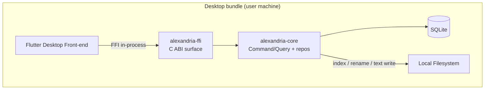

# Operations & Infrastructure Document — Alexandria

## 1. Introduction

### 1.1 Purpose

This document captures **cross-cutting platform concerns** for **Alexandria** that
fall outside the business domain modeled in the
[Vision Document](Vision%20Document.md),
[System Requirements Document](System%20Requirements%20Document.md), and
[Use Case Specification Document](Use%20Case%20Specification%20Document.md).

These are functional capabilities of the *platform* rather than the domain, so
they are documented here to keep the domain documents focused while still
tracking the work formally. The specific technologies and versions this platform
is built on are defined once in the
[Technology Stack Document](Technology%20Stack%20Document.md) and referenced from
here rather than duplicated.

### 1.2 Scope

This document covers the technical foundation and repository layout, platform
requirements, configuration, logging and monitoring, environments, and build
and delivery. The health endpoint is removed with the HTTP server (§5).

---

## 2. Technical Foundation

### 2.1 Overview

Alexandria is a two-crate Cargo workspace built on a Rust core library. The
core library carries the domain logic (Command/Query handlers, repository traits
and the sqlx implementation, text-file port); an FFI crate exposes its
operations to the Flutter desktop front-end through a C ABI, called in process.
There is no server and no login: the core only runs locally, for the person at
the machine. The domain documents describe *what* the system does;
this section describes the structural foundation those features are built on.

### 2.2 Solution Architecture



### 2.3 Repository Layout

```
alexandria-api/
├── Cargo.toml                 # workspace
├── crates/
│   ├── alexandria-core/
│   │   ├── src/
│   │   │   ├── catalog/       # commands, queries, repos (File + subtypes)
│   │   │   ├── libraries/
│   │   │   ├── collections/
│   │   │   ├── bookmarks/
│   │   │   ├── watchlists/
│   │   │   ├── reading_lists/
│   │   │   ├── playback/
│   │   │   ├── settings/
│   │   │   ├── errors.rs      # thiserror domain errors
│   │   │   └── lib.rs
│   │   ├── migrations/        # sqlx migrations
│   │   └── tests/
│   └── alexandria-ffi/
│       ├── src/
│       │   ├── lib.rs         # extern "C" surface
│       │   └── header.h       # generated by cbindgen
│       ├── build.rs
│       └── tests/
├── config.toml.example
└── docs/
    ├── initial/
    └── requirements/
```

### 2.4 Platform Requirements

| ID | Requirement |
| --- | --- |
| IR-01 | The solution shall be a Cargo workspace with two crates — `alexandria-core`, and `alexandria-ffi`, a thin C ABI over the core library. |
| IR-02 | The workspace shall enforce `#![deny(unsafe_code)]` in every crate. |
| IR-03 | **Removed (the core only runs locally for the person at the machine)** |
| IR-04 | The core library shall expose domain operations through repository **traits**, so the handlers depend on abstractions and remain independently testable, and the FFI layer stays a thin transport over them. |
| IR-05 | Database migrations shall run when the core is initialized (`alexandria_index_init`), before it answers any other call. |
| IR-06 | The solution shall generate a C header for the FFI surface (via cbindgen) as part of the build, for the Flutter front-end to consume. |

### 2.5 Migrations are append-only — with one pre-release exception

sqlx records a checksum of every applied migration's **file content** and
refuses to run against a database whose stored checksum no longer matches,
failing with `VersionMismatch`. Editing a migration that has already run —
including changing only a comment — therefore breaks every existing database,
not just schema-relevant edits. IR-05 runs migrations before the core answers
any call, so such a database does not degrade: it fails initialization
outright, with `DomainError::Migration`.

The rule: once a migration has been applied anywhere it must be treated as
frozen; corrections go in a new migration. A database that has drifted (because
a migration was edited before this rule was written down) is repaired by
re-syncing the stored checksum, or, in development, by deleting the database
file and letting it rebuild:

```sql
-- inspect what the database believes it applied
SELECT version, description, checksum FROM _sqlx_migrations ORDER BY version;
```

#### The pre-release exception

Until the first packaged release described in §7 Build & Delivery, the
**baseline migrations may be amended in place** rather than corrected by a new
one. A baseline migration is one that establishes a table's shape rather than
changing it, and each says so in its own header comment
(`00000000000001_catalog.sql`, `00000000000011_catalog_runs.sql`). Anything
that is not a baseline is frozen by the rule above from the moment it merges.

Two facts make this the cheaper answer for now, and both expire:

* The only deployment is the single-user desktop bundle of §6, and packaging
  it is still deferred (§7). There is no installed base to migrate — the
  databases in existence are development ones and the maintainer's own.
* A settled table read in one file beats the same table reconstructed from a
  chain of `ALTER TABLE`s, and the indexing schema was still moving:
  `size_bytes`/`mtime` replaced hash-based change detection, and the run
  record grew progress, pause, priority, and segment columns.

What the exception costs, stated plainly: **an existing database is deleted
and rebuilt, not migrated.** A user who upgrades across an amendment gets
`DomainError::Migration` at initialization and must delete the database file, losing
their catalog and re-indexing. That is acceptable only because the catalog is
derived from files on disk and can be rebuilt by re-running the index. Every
amendment must therefore be announced as a breaking change in the README's
[Upgrading](../../README.md#upgrading) section.

This exception ends at the first packaged release. From then on the rule above
is unconditional and the baselines are frozen like everything else.

---

## 3. Configuration

Configuration is read from `config.toml` (or the file `ALEXANDRIA_CONFIG`
names) when the core is initialized, with `ALEXANDRIA_*` environment variables
overriding a key. Unknown keys and tables are ignored; invalid values for
required keys fail initialization. The table below is the complete set of
keys — a key not listed here does not exist, and only the keys showing an
`ALEXANDRIA_*` name have an environment override.

| Concern | Mechanism | Notes |
| --- | --- | --- |
| `database.path` | config / `ALEXANDRIA_DATABASE_PATH` | SQLite file path; bundled beside the desktop app's data dir. |
| `filesystem.root` | config / `ALEXANDRIA_FILESYSTEM_ROOT` | the library root. It **bounds what the catalog can reach** (FR-FC-26): adding a library (UC-51) and indexing one (UC-01) reject a folder that is neither it nor a descendant of it, correcting a library's root (UC-51) rejects a folder outside it (a folder that does not exist yet is judged by its nearest existing ancestor, so an unplugged drive mounted inside the root is still accepted), and streaming, comic pages, thumbnails, text reads and edits, renames, and purge-on-disk refuse a cataloged file whose path resolves outside it. Empty — the default — turns the bound off: nothing is bounded, so any absolute folder a caller supplies can be added as a library and a library can be corrected to any folder. Initialization logs a warning while it is unset. Setting it on an installation whose libraries lie elsewhere leaves their files refused until those libraries are removed and their folders added under the root. UC-02 takes no root and is unaffected either way. |
| `indexing.concurrency` | config / `ALEXANDRIA_INDEXING_CONCURRENCY` | how many files a `normal`-priority UC-01 index or UC-02 re-index walk processes at a time (FR-FC-08, FR-FC-31); default `4`, `0` is treated as `1`. The filesystem half runs on the blocking pool, so this is real parallelism; the DB half still serializes behind SQLite's single writer and the 8-connection pool, so values far above that buy nothing. |
| `indexing.low_priority_concurrency` | config / `ALEXANDRIA_INDEXING_LOW_PRIORITY_CONCURRENCY` | the same width for a run started — or resumed (FR-FC-33) — at `low` priority (FR-FC-31); default `1`, `0` is treated as `1`. A low-priority scan is meant to stay out of the way of browsing and playback rather than to finish fast, which is why the default is sequential. |
| `deletion.retention_days` | config / `ALEXANDRIA_DELETION_RETENTION_DAYS` | soft-delete retention window; default `30` (NFR-10). |
| `logging.level` | config / `ALEXANDRIA_LOGGING_LEVEL` | `error` / `warn` / `info` / `debug` / `trace`; default `info`. |
| `playback.thumbnail_cache_dir` | config / `ALEXANDRIA_PLAYBACK_THUMBNAIL_CACHE_DIR` | directory holding thumbnails generated by UC-40, created on first use; default `thumbnails`. Entries are keyed by the file's UUID, its recorded modification time, and the target dimension (UC-40), so a re-index that picks up a new modification time invalidates that file's thumbnail for free; nothing evicts old entries. |

**Secrets:** the core holds none. Authentication is removed (the core only
runs locally for the person at the machine), and with it the local-login
credential, the sessions, the recovery codes and every Heimdall and Windows
setting. Migration 30 deletes what an older catalog stored. The `[auth]` and
`[http]` sections are gone from the table above: a `config.toml` that still
holds them loads, and they are ignored, as are the `ALEXANDRIA_AUTH_*` and
`ALEXANDRIA_HTTP_*` environment variables.

---

## 4. Logging & Monitoring

Logging uses structured, span-aware logs via `tracing` / `tracing-subscriber`
(see the [Technology Stack Document](Technology%20Stack%20Document.md)).

| Concern | Approach |
| --- | --- |
| Log format | structured (JSON to file; human-readable to console in dev) |
| Destination | console in development; rotating log file in the desktop app's data directory |
| Span fields | `use_case`, `request_id`, `file_uuid`, `operation` on relevant spans |
| Never logged | file contents |

A log line is emitted for indexing progress (files indexed, skipped, already
cataloged, failed) and for every catalog write at `info`; validation denials
are `warn`; disk and integrity failures are `error`. Initialization logs how
many runs it found still marked `running` and recorded `paused` for resume
(FR-FC-29), so an operator can see that a previous process stopped mid-scan.

---

## 5. Health & Monitoring Endpoints

**Removed (the core only runs locally for the person at the machine)**

There is no server to probe. The client loads the core in process, and
`alexandria_index_init` reports a database it cannot open or migrate.
`alexandria_health_status_code()` still answers `200` once the library is
loaded; it probes nothing.

### 5.3 Use Case — UC-37: Health check

**Withdrawn (the core only runs locally for the person at the machine)**

---

## 6. Environments

| Environment | Purpose | Differences |
| --- | --- | --- |
| **Local** | single-user desktop use; the Flutter app loads the core in process | SQLite file in the app's data dir, migrations run at initialization |
| **Test** | automated tests | in-memory or temp-file SQLite, temp filesystem root, fixed clock |

There is no staging or multi-instance production environment; Alexandria is a
single-user, single-process desktop deployment.

---

## 7. Build & Delivery

- **Build:** `cargo build --workspace` produces the FFI dynamic library;
  `cbindgen` generates the C header consumed by Flutter.
- **Tests:** `cargo test` (see the
  [Testing Specification Document](Testing%20Specification%20Document.md)).
- **Packaging:** this repository publishes no packages of its own. The FFI
  library travels inside the desktop application's packages, which
  [alexandria-ui](https://github.com/artur-rios/alexandria-ui)'s release
  workflow builds from a pinned commit of this repository (its `CORE_REF`). In
  the desktop application the SQLite database file
  lives in its per-user application-support directory. Installer formats and
  bundling are documented in that repository.
- **Releases:** a release is the tag `vx.y.z` on the merge commit of a
  `release/x.y.z` pull request into `main`; the version is the workspace version
  in `Cargo.toml`. The branching model, the versioning policy, and the procedure
  are in [CONTRIBUTING.md](../../CONTRIBUTING.md#releasing).

---

## 8. Traceability

| Platform capability | Requirements |
| --- | --- |
| Two-crate workspace: the core and its C ABI | IR-01, IR-04 |
| Memory safety | IR-02 |
| Loopback HTTP binding | **Removed (the core only runs locally for the person at the machine)** |
| Startup migrations | IR-05 |
| FFI header generation | IR-06 |
| Health endpoint | **Removed (the core only runs locally for the person at the machine)** (UC-37 withdrawn) |