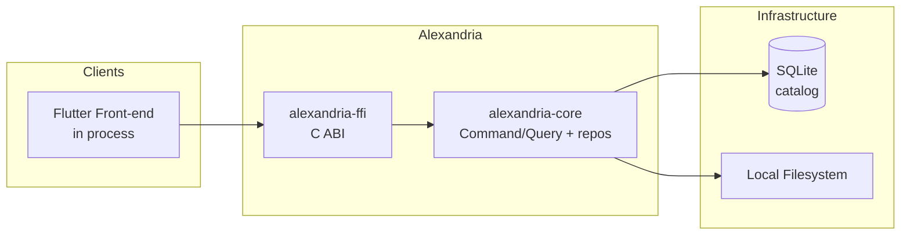
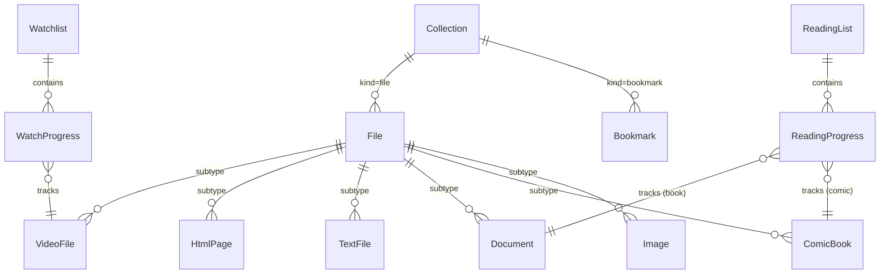
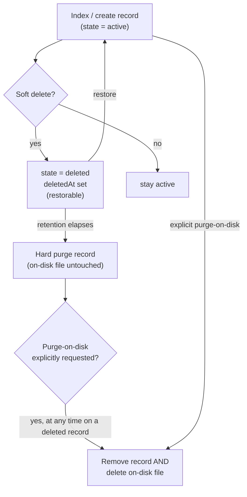

# System Requirements Document — Alexandria

## 1. Introduction

### 1.1 Purpose

This document specifies the functional and non-functional requirements for
**Alexandria**.

The concrete technology stack — platform and language versions, libraries,
database, and tooling — is defined in the
[Technology Stack Document](Technology%20Stack%20Document.md). This document
states requirements and refers to that one for specific technologies and versions
rather than restating them.

### 1.2 Scope

The requirements cover seven capability areas: file catalog and indexing (FC),
collections (CO), bookmarks (BM), watchlists (WL), reading lists (RL), text file
content editing (TX), and media playback (MP). Authentication and authorization
(AU) is removed: the core only runs locally for the person at the machine.
Non-functional requirements apply across all areas. Operational platform
concerns (logging, configuration, deployment) are specified in the
[Operations & Infrastructure Document](Operations%20%26%20Infrastructure%20Document.md).

### 1.3 Definitions

| Term | Definition |
| --- | --- |
| **File** | An indexed on-disk resource inside a library (FR-FC-36). One of seven subtypes: AudioFile, VideoFile, HtmlPage, TextFile, Document, ComicBook, Image. |
| **Path** | The absolute on-disk location of a File. Unique across the catalog. |
| **Content hash** | SHA-256 hash of a File's bytes. Informational, and usually absent: indexing and re-index never compute one (FR-FC-09, FR-FC-10). The only thing that writes it is the post-write verification of a text edit (FR-TX-03). |
| **Stat pair** | A File's `sizeBytes` and `mtime`, both taken from the directory entry during the walk. Together they are the change signal a re-index compares (FR-FC-10). |
| **Run** | One index or re-index execution, recorded and addressable by a run id (FR-FC-27). Non-terminal statuses are `running` and `paused`; terminal ones are `complete`, `failed`, and `cancelled`. |
| **Run priority** | How hard a run pushes: `normal` or `low`, chosen when the run is started (FR-FC-31) and again, optionally, each time it is resumed (FR-FC-33). Fixed for the length of one segment, not for the life of the run; a resume that names none keeps the width the run already has. |
| **State** | A File or Bookmark lifecycle state: `active`, `deleted` (soft), or purged. |
| **mediaKind** | VideoFile discriminator: `movie` or `series`. |
| **formatKind** | Document discriminator: `book` or `ebook`. |
| **Watch/Read state** | Progress state: `Pending`, `Watching`/`Reading`, `Watched`/`Read`. |
| **Playback descriptor** | The FFI answer to UC-38: the resolved absolute path, MIME type, and byte size of a File, from which a local client opens the file itself. The FFI surface cannot carry a byte stream. |

---

## 2. System Overview

---

## 3. Functional Requirements

### 3.1 File Catalog & Indexing (FC)

| ID | Requirement |
| --- | --- |
| FR-FC-01 | The system shall index the files of a library (FR-FC-36): walk its folder and, for every file of a type it can read, create a File record with path, name, type, size, and modification time (FR-FC-09), plus a subtype record, belonging to that library (FR-FC-37). Audio files are indexed as AudioFiles, alongside the other types. Its metadata fields are prefilled from the file's own embedded metadata at first index (FR-FC-25) and are editable by the owner via FR-FC-14 through FR-FC-18. A file of any other type is counted as `skipped` (FR-FC-27). A run always covers every type the system can read: a library is the folder as it is, so there is no per-run type scope, and the run's root is the library's folder at the moment it starts. Indexing is started by adding a library (FR-FC-36) or by re-indexing one on the owner's request; there is no way to index a folder that is not a library. |
| FR-FC-02 | The system shall index video files as VideoFiles. Title, year, resolution and duration are prefilled from the container at first index (FR-FC-25), but `mediaKind` (movie/series) is owner-supplied via FR-FC-15: nothing in a video file distinguishes a movie from an episode, so indexing does not infer it. |
| FR-FC-03 | The system shall index saved HTML pages. |
| FR-FC-04 | The system shall index Markdown and plain-text files as TextFiles. |
| FR-FC-05 | The system shall index PDF and e-book files as Documents. Title, author and page count are prefilled from the file's own metadata at first index, and `formatKind` is set from the format itself — `book` for PDF, `ebook` for EPUB (FR-FC-25). Both remain editable by the owner via FR-FC-16. |
| FR-FC-06 | The system shall index comic-book files (CBR/CBZ) as ComicBooks. Title, series and issue metadata are prefilled from the archive's `ComicInfo.xml` when it has one (FR-FC-25) and are editable by the owner via FR-FC-17. A `.pdf` indexes as a Document (FR-FC-05): file extension alone cannot distinguish a comic PDF from a book PDF. |
| FR-FC-07 | The system shall index image files. |
| FR-FC-08 | The system shall run indexing asynchronously and shall not block read/query operations while indexing is in progress. Filesystem work (directory walks, file stats, metadata parsing) shall run off the async runtime's worker threads, and the index and re-index walks shall process a bounded number of files concurrently rather than one at a time. That bound is the run's priority (FR-FC-31) resolved against configuration: `indexing.concurrency` (default 4) for `normal`, `indexing.low_priority_concurrency` (default 1) for `low`. |
| FR-FC-09 | The system shall record, for each indexed file, its path, name, type, size in bytes, and last-modification time, all taken from the directory entry. Indexing shall not read the contents of the file for the purpose of identifying or fingerprinting it, and shall leave the File's content hash unset. Metadata extraction (FR-FC-25) reads only as much of a file as its own format demands, which is why the cost of a scan is set by the number of files in the library rather than by their total size (NFR-02). |
| FR-FC-10 | The system shall, on re-index, compare each cataloged path's recorded size and modification time against the file now on disk, and shall treat a difference in either as a change. For a changed file the system shall store the new size and modification time, update `indexedAt`, and clear the File's stored content hash, so that a hash cannot outlive the bytes it described. Re-index shall read no file contents and shall compute no hash. A file whose size and modification time are both unchanged is recorded unchanged. |
| FR-FC-11 | The system shall, on re-index, detect a path that no longer exists on disk and set the File's `missingAt` marker without deleting the record or changing its `state`. |
| FR-FC-12 | The system shall list and query files across every library, filtered by type, lifecycle state, containing collection (FR-CO-07), and library, answering each matching file as the same record its single-file lookup (FR-FC-13) would answer: the File plus its library, its subtype metadata and extracted scalars. A malformed library or collection identifier is invalid input; a well-formed one that names nothing matches no files. |
| FR-FC-13 | The system shall return a single file's metadata by its public UUID. |
| FR-FC-14 | The system shall allow editing audio metadata (title, artist, album, year, genre, track, albumArtist). An audio file's duration is read from the stream at index time and reported beside its metadata, as a video's is (FR-FC-02); it is not owner-editable. |
| FR-FC-15 | The system shall allow editing video metadata (title, year, resolution; `mediaKind` movie/series). |
| FR-FC-16 | The system shall allow editing document metadata (title, author, year; `formatKind` book/ebook). |
| FR-FC-17 | The system shall allow editing comic-book metadata (title, series, issueNumber). |
| FR-FC-18 | The system shall allow editing image metadata (title, caption). |
| FR-FC-19 | The system shall allow renaming a File, which renames the underlying file on disk. |
| FR-FC-20 | The system shall soft-delete a File record by marking it `deleted`, hiding it from active views, and keeping it restorable. |
| FR-FC-21 | The system shall restore a soft-deleted File to `active`. |
| FR-FC-22 | The system shall hard-purge a File record permanently only after its soft-delete retention window has elapsed. |
| FR-FC-23 | The system shall, on an explicit purge-on-disk operation, remove the File record and delete the underlying file on disk. |
| FR-FC-24 | **Removed (the core only runs locally for the person at the machine)** |
| FR-FC-25 | The system shall prefill a file's subtype metadata from the metadata embedded in the file itself (audio tags, image EXIF, document and comic metadata, video container metadata) at first index, and shall record which extraction wrote the row. Extraction is best-effort: a failure leaves the fields empty and never fails the file's indexing. The row is stamped either way — the stamp records which extraction was applied, not which one succeeded — so a file nothing can be read from is opened once rather than on every later pass. On re-index (FR-FC-10) the system shall re-read a file whose row an older extraction wrote and shall **fill only the subtype fields the catalog is missing**, leaving every field that already holds a value — an owner's edit (FR-FC-15..18) or an earlier extraction's — exactly as it is, and shall then stamp the row so the file is read once rather than once per run. |
| FR-FC-26 | The system shall bound what the catalog can reach by the configured `filesystem.root`, in three places. It shall reject adding a library (FR-FC-36) whose folder, an index run (FR-FC-01) whose root, and a library root correction (FR-FC-41) whose new root, is not the configured root or a descendant of it. And it shall refuse to read, stream, decode, write, rename, or delete the on-disk file of a catalog record whose path does not resolve inside it (UC-05, UC-09, UC-32, UC-33, UC-38 – UC-40), so that a record already pointing outside — catalogued before the bound was configured, or reached through a symbolic link swapped in since — is not served. Paths are compared after resolving each to its canonical form, so that traversal segments, trailing separators, and symbolic links cannot escape the bound. A path that does not exist yet — a library corrected to a folder on a drive that is not plugged in — is resolved through its longest existing ancestor, with the remaining segments normalised lexically, so such a folder inside the root is still accepted; a path that cannot be resolved at all (a dangling symbolic link, a folder the server may not look into) is treated as outside. When `filesystem.root` is set but cannot itself be resolved, all three are refused with a distinct error rather than left unconstrained. When `filesystem.root` is unset, none of this applies and any path is accepted — the constraint is opt-in by configuration. Re-index (FR-FC-10, FR-FC-11) takes no root and is unaffected. |
| FR-FC-27 | The system shall record every index and re-index run: its id, kind, start time, status, finish time once it has one, and the outcome counts for its kind. A run's status shall be one of `running`, `paused`, `complete`, `failed`, or `cancelled`; `running` and `paused` are the non-terminal ones. Its counts shall be `scanned`, `indexed`, `skipped` (classified out), `alreadyCataloged` (a path the catalog already held), and `failed` for an index run, and `refreshed`, `markedMissing`, `unchanged`, and `failed` for a re-index. `skipped` and `alreadyCataloged` are counted apart so that a resumed run's tally describes what it actually did rather than reporting every entry an earlier segment cataloged as a skip. A run whose walk completes shall be recorded `complete` even when individual files failed — those are counted in the run's `failed` tally, and one file's failure shall not abandon the rest of the walk. A run that could not proceed at all shall be recorded `failed` with the underlying error. |
| FR-FC-28 | The system shall expose a run's recorded status and outcome to a caller, given the run id returned when the run was started. While the run is in flight the answer shall also carry its live progress: `phase` (`discovering` while the entries are still being counted, `processing` once they are, and absent once the run is terminal), `total` (absent until discovery has finished counting), `processed` (entries the current segment has finished with), `activeMillis` (elapsed time with paused stretches subtracted), and `pausedAt` for a run that is paused right now. A run this process is no longer executing shall still report the last progress it published, so a run paused across a restart can still say how far it got. The system shall not report a remaining-time estimate: `processed`, `total`, and `activeMillis` are the inputs a client cannot derive for itself, and smoothing an estimate over them is a presentation decision. |
| FR-FC-29 | The system shall, at startup, record every run still marked `running` as `paused` and offer it for resume (FR-FC-33); runs execute in-process, so such a run provably has no task behind it. Nothing shall resume by itself — resuming is an explicit act by the owner. |
| FR-FC-30 | The system shall report the configuration a client needs to render the catalog correctly, beginning with the soft-delete retention window it enforces on every restore and purge. |
| FR-FC-31 | The system shall accept a priority — `normal` or `low` — when an index or re-index run is started, treating an absent or unrecognised value as `normal` rather than rejecting the call, and shall resolve it to the concurrency bound FR-FC-08 applies. The priority shall be stored on the run and reused when the run is resumed, so a resumed run continues at the width it was last set to rather than at whatever configuration happens to say later. It is fixed for the length of one segment: it cannot be changed while a run is walking, but a resume may name a new one (FR-FC-33), so an owner who changes their mind pauses and resumes rather than losing the run. |
| FR-FC-32 | The system shall pause a `running` index or re-index run on the owner's request, leaving it recorded `paused` with the point it reached and with no finish time, so that it can be resumed later. A pause requested against a run in any other status shall be refused as a conflict rather than silently accepted. |
| FR-FC-33 | The system shall resume a `paused` index or re-index run on the owner's request, recording it `running` again and continuing it under the same run id, with the time it spent paused excluded from its `activeMillis`. A resumed index run re-walks its root and a resumed re-index re-visits every cataloged path; entries an earlier segment already cataloged are counted in `alreadyCataloged`. A resume shall accept a priority of its own — `normal` or `low`, spelled exactly as FR-FC-31 spells them — and shall walk the resumed segment at the concurrency that priority resolves to, storing it on the run so the new pacing survives a further pause. An absent or unrecognised priority shall keep the width the run already has rather than resetting it to `normal`: sending nothing is not a request to speed up, and every caller predating the option sends nothing. This is how a large scan started at `normal` is throttled down once the owner wants the application back, without losing the work already done or the run's record. A resume requested against a run in any other status shall be refused as a conflict, and refusing it shall leave the run's stored priority untouched. |
| FR-FC-34 | The system shall cancel a `running` or `paused` index or re-index run on the owner's request, recording it `cancelled` with a finish time and with the progress it last published. Where a walk was executing, the partial tally it had reached is kept as well; a run no process is executing has none to offer, and is recorded without counts rather than with invented ones. `cancelled` is terminal: a cancelled run shall never be resumed. A cancel requested against an already-terminal run shall be refused as a conflict. |
| FR-FC-35 | The system shall report every outstanding run — every run whose status is `running` or `paused` — in one call, newest first, each carrying the same body FR-FC-28 defines. A caller with nothing outstanding shall receive an empty list rather than an error. This is what lets a client show whether anything is indexing and offer a resume at launch without having to remember every run id it ever started. |
| FR-FC-36 | The system shall add a named folder as a *library* — the only way files enter the catalog — and start its first index run (FR-FC-01) in the same request, at an optional priority (FR-FC-31), answering the library with the run's id. Adding is refused, storing nothing, when the name or folder is blank, the folder does not exist or is not a folder, it lies outside the configured `filesystem.root` (FR-FC-26), or it contains or sits inside a library already added, in which case the refusal names the existing library. A library whose first run cannot be opened is not left behind. |
| FR-FC-37 | The system shall keep every catalogued file in exactly one library: the library whose run recorded it. A file is never written without one, and libraries never nest or overlap, so no file has two answers to which library holds it. |
| FR-FC-38 | The system shall answer a library's files everywhere a file can be listed or referenced — the file listing (FR-FC-12), a single-file read, and every collection, watchlist, and reading list that references them. Nothing is hidden from the listing; a caller narrows it to one library with a library filter. |
| FR-FC-39 | The system shall report one level of a library at a time — the folders directly inside the addressed folder, and the files directly in it — rather than the whole tree. A course with two hundred classes is a large document to build, send, and parse so the owner can look at the six things in one folder. |
| FR-FC-40 | The system shall remove a library on request, deleting its catalog records: every file record in it with its subtype record, watch and reading progress, and collection membership; its index runs; and every run failure recorded under its folder. Files on disk are never touched, and adding the folder again re-indexes it. Removal is refused while one of the library's runs is running (FR-FC-43); a paused run goes with the library. |
| FR-FC-41 | The system shall correct a library's root folder on request, moving the stored paths of the files it holds to match, so that a folder that moved on disk is one record to correct rather than a catalog to re-walk. The files keep their identity — a re-index at the new location would mint new records and leave every watchlist place, reading position, and collection membership pointing at records that had gone missing. The correction is refused when the destination overlaps another library, when the catalog already holds files there, or when it lies outside the configured `filesystem.root` (FR-FC-26), and while the library has an unfinished run (FR-FC-43), whose resume would walk the old folder. |
| FR-FC-42 | The system shall record which files a run could not process, each with the reason it gave up, and answer that list for a run on request. The tally already says how many; without the paths a client can only tell the owner a number about files that are on disk, in no listing, and named nowhere they can reach. The list is bounded per run — a folder whose every file fails must not write a row per file — and the tally remains the authority on how many there were. Recording a failure is best-effort: a walk that cannot write the note carries on rather than abandoning the rest of the library. |
| FR-FC-43 | The system shall allow a library at most one unfinished index run — `running` or `paused`, which is also what a run interrupted by a stop becomes. While one exists, a second index run of the library and a correction of its root are refused as a conflict naming the run, and removal is refused while that run is `running`. The owner cancels or finishes the run first (FR-FC-34). Refusing rather than waiting: a cancel only signals the walk, in whichever process it runs. The store itself holds the rule, so two requests that both pass the check still start only one run. |
| FR-FC-44 | The system shall let the owner pin a library or unpin it, storing the choice as the library's `pinned` flag and reporting it on every answer that carries the library — the listing, a browse, and the answers to adding and renaming it. A library is unpinned when it is added, and so is every library a catalog held before the flag existed. Setting the value a library already has succeeds and changes nothing; a malformed identifier is invalid input and one naming no library is not found. Correcting the library's root (FR-FC-41), renaming it (FR-FC-46) and re-indexing it keep the flag; removing it (FR-FC-40) removes the flag with it. The system shall put no order on the listing: pinned libraries first is the client's presentation. |
| FR-FC-45 | The system shall let the owner mark a library as a favorite or clear the mark, storing it as the library's `favorite` flag, independent of `pinned`, and reporting it wherever FR-FC-44 reports the pin. It is unset when a library is added and on every library a catalog held before the flag existed; setting the value it already has changes nothing; and it is kept and removed exactly as the pin is. |
| FR-FC-46 | The system shall rename a library on request, at any time — including while the library has a `running` or `paused` run, since no run reads the name. The new name is checked by the rule adding a library uses (FR-FC-36): a blank name is refused and nothing is stored. The name is stored trimmed, two libraries may share one, and renaming to the current name succeeds and changes nothing. The answer is the updated library. |
| FR-FC-47 | The system shall report the catalog's totals in one call: the number of libraries, and the number of files of each of the seven file types, every type present with `0` when the catalog holds none of it, so a client never has to tell "none" from "missing". A file is counted when the default file listing (FR-FC-12) shows it: an `active` file, including one marked missing (FR-FC-11); a soft-deleted file is not. The totals cover the whole catalog, not one library. |

### 3.2 Collections (CO)

| ID | Requirement |
| --- | --- |
| FR-CO-01 | The system shall create a file collection (name, `kind` = file). |
| FR-CO-02 | The system shall create a bookmark collection (name, `kind` = bookmark). |
| FR-CO-03 | The system shall rename a collection. |
| FR-CO-04 | The system shall delete a collection by unlinking (preserving) its contained items, not deleting them. |
| FR-CO-05 | The system shall add items of the matching `kind` to a collection, linking those it can and reporting for every submitted item whether it was added and, when it was not, whether it was of the other kind or does not exist. |
| FR-CO-06 | The system shall remove items from a collection. |
| FR-CO-07 | The system shall list the items in a collection. |
| FR-CO-08 | The system shall list the owner's collections, optionally filtered by `kind`, each with the number of items it currently holds. |

### 3.3 Bookmarks (BM)

| ID | Requirement |
| --- | --- |
| FR-BM-01 | The system shall create a bookmark (url, title) in a bookmark collection. |
| FR-BM-02 | The system shall update a bookmark's url, title, and containing collection. |
| FR-BM-03 | The system shall soft-delete a bookmark (mark `deleted`, restorable). |
| FR-BM-04 | The system shall hard-purge a bookmark after its retention window elapses. |
| FR-BM-05 | The system shall restore a soft-deleted bookmark. |
| FR-BM-06 | The system shall list and query bookmarks by containing collection. |

### 3.4 Watchlists (WL)

| ID | Requirement |
| --- | --- |
| FR-WL-01 | The system shall create a watchlist (name). |
| FR-WL-02 | The system shall add a VideoFile to a watchlist, creating a WatchProgress in the `Pending` state. |
| FR-WL-03 | The system shall reject adding a non-VideoFile to a watchlist. |
| FR-WL-04 | The system shall update a WatchProgress state (`Pending` → `Watching` → `Watched`). |
| FR-WL-05 | The system shall track watch progress per episode for a series VideoFile. |
| FR-WL-06 | The system shall remove a video from a watchlist, deleting its WatchProgress. |
| FR-WL-07 | The system shall delete a watchlist, removing its WatchProgress entries only and preserving its VideoFiles. |
| FR-WL-08 | The system shall list watchlists and the watch progress of their items. |

### 3.5 Reading Lists (RL)

| ID | Requirement |
| --- | --- |
| FR-RL-01 | The system shall create a reading list (name). |
| FR-RL-02 | The system shall add a Document or ComicBook to a reading list, creating a ReadingProgress in the `Pending` state. |
| FR-RL-03 | The system shall reject adding a non-read-eligible file (any type other than Document or ComicBook) to a reading list. |
| FR-RL-04 | The system shall update a ReadingProgress state (`Pending` → `Reading` → `Read`). |
| FR-RL-05 | The system shall track reading progress per issue for a comic-book series. |
| FR-RL-06 | The system shall remove an item from a reading list, deleting its ReadingProgress. |
| FR-RL-07 | The system shall delete a reading list, removing its ReadingProgress entries only and preserving its files. |
| FR-RL-08 | The system shall list reading lists and the reading progress of their items. |

### 3.6 Text File Editing (TX)

| ID | Requirement |
| --- | --- |
| FR-TX-01 | The system shall read the content of a TextFile from disk. |
| FR-TX-02 | The system shall write edited content back to the TextFile on disk. |
| FR-TX-03 | The system shall recompute and update the TextFile's content hash after a successful content write. |

### 3.7 Authentication & Authorization (AU)

**Removed (the core only runs locally for the person at the machine)**

### 3.8 Media Playback (MP)

| ID | Requirement |
| --- | --- |
| FR-MP-01 | The system shall give a local client what it needs to play an `active` File from its recorded path: a **playback descriptor** carrying the resolved absolute path, a MIME type derived from the file's extension, and the byte size (FR-MP-06). |
| FR-MP-02 | **Removed (the core only runs locally for the person at the machine)** |
| FR-MP-03 | The system shall never re-encode, transcode, or otherwise modify the bytes it serves. |
| FR-MP-04 | The system shall return a single page of a CBZ ComicBook as an image, addressed by 1-based page index. |
| FR-MP-05 | The system shall return a downscaled thumbnail image for a video, image, comic, or audio File. For audio, the thumbnail is the front-cover picture embedded in the file's own tag; a file with no embedded picture returns no thumbnail. |
| FR-MP-07 | **Removed (moved out of scope, see Orpheus)** |
| FR-MP-06 | The system shall expose playback operations over the FFI. Because the FFI cannot carry a byte stream, FR-MP-01 returns a **playback descriptor** — resolved absolute path, MIME type, and byte size — and the local client opens the path itself. FR-MP-04 and FR-MP-05 return their bytes in the answer, unmodified from what was read or rendered. |

### 3.9 Playlists (TR)

**Removed (moved out of scope, see Orpheus)**

### 3.10 Music Enrichment (EN)

**Removed (moved out of scope, see Orpheus)**

### 3.11 Play History (PH)

**Removed (moved out of scope, see Orpheus)**

---

## 4. Data Model

### 4.0 Identifier Strategy

Every entity has an **internal integer primary key** used inside the database for
joins and foreign keys, plus a **public UUID** (v4) that is the stable external
identifier exposed to clients over the FFI. The `uuid` arguments and
request/response bodies used throughout the
[Use Case Specification Document](Use%20Case%20Specification%20Document.md) refer
to this public UUID.

### 4.1 Entity Relationship Diagram

### 4.2 File Fields

| Field | Type | Constraints | Description |
| --- | --- | --- | --- |
| id | integer | PK, autoincrement | Internal primary key. |
| uuid | UUID | required, unique | Public identifier. |
| path | text | required, unique | Absolute on-disk path. |
| name | text | required | Editable file name. |
| type | enum | required; one of `audio`, `video`, `html`, `text`, `document`, `comic`, `image` | Subtype discriminator. |
| libraryId | integer | required, FK → Library | The library the file belongs to (FR-FC-37). Exposed on a listed or read file as the library's `libraryUuid`. |
| contentHash | text | nullable | SHA-256 of the file bytes, when one is known. `NULL` is the normal state: indexing and re-index never compute one (FR-FC-09, FR-FC-10), and a re-index clears it on a changed file. The only writer is the post-write verification of a text edit (FR-TX-03). Informational — nothing reads it back as a decision input. |
| sizeBytes | integer | nullable | The file's size on disk at the last index or re-index; half of the change signal (FR-FC-10). |
| mtime | timestamp | nullable | The file's last-modification time on disk at the last index or re-index; the other half of the change signal (FR-FC-10), and part of the thumbnail cache key (FR-MP-05). |
| state | enum | required; one of `active`, `deleted` | Lifecycle state. |
| deletedAt | timestamp | nullable | Set when soft-deleted; drives the retention window. |
| indexedAt | timestamp | required | Last index/re-index time. |
| missingAt | timestamp | nullable | Set by re-index when the on-disk file is gone (FR-FC-11); cleared when it returns. Orthogonal to `state`: a file may be `active` and missing. |
| metadataVersion | integer | required, defaults to 0 | Which extraction wrote the row's subtype metadata (FR-FC-25). Zero is "an extraction that predates this column", which is what every row indexed by an earlier build is; a re-index re-reads anything behind the current version and stamps it. Internal only — nothing on the wire carries it. |
| collectionId | integer | nullable, FK → Collection | Containing collection, if any. Internal only: it is never exposed on the `File` payload, because it is an internal key and its public counterpart is reachable the other way round — `alexandria_collection_list_items` (FR-CO-07) lists a collection's members, and `alexandria_files_list` with a `collectionUuid` filter (FR-FC-12) filters by it. |

Type-specific subtype tables (AudioFile, VideoFile, HtmlPage, TextFile,
Document, ComicBook, Image) share the File's `id` as a foreign key and carry only their
type-specific metadata. Representative subtype fields:

| Subtype | Extra Fields |
| --- | --- |
| AudioFile | title, artist, album, year, genre, track, albumArtist, durationSeconds |
| VideoFile | title, year, resolution, mediaKind (movie/series), episodeCount (series), durationSeconds |
| HtmlPage | title, sourceUrl, savedAt |
| TextFile | (content is read/written on disk, not stored) |
| Document | title, author, year, formatKind (book/ebook), pageCount |
| ComicBook | title, series, issueNumber, comicPageCount |
| Image | title, caption, width, height |

### 4.3 Collection Fields

| Field | Type | Constraints | Description |
| --- | --- | --- | --- |
| id | integer | PK | Internal primary key. |
| uuid | UUID | required, unique | Public identifier. |
| name | text | required, non-empty | Collection name. |
| kind | enum | required; one of `file`, `bookmark` | Discriminator. |

A collection carries no item count of its own: the number is derived by counting
the rows that point at it, so it cannot drift from the membership. `FR-CO-08`'s
listing returns that derived count alongside each collection, excluding
soft-deleted members — the same members `FR-CO-07` lists.

### 4.4 Bookmark Fields

| Field | Type | Constraints | Description |
| --- | --- | --- | --- |
| id | integer | PK | Internal primary key. |
| uuid | UUID | required, unique | Public identifier. |
| url | text | required, valid URL | The bookmarked URL. |
| title | text | required, non-empty | Bookmark title. |
| state | enum | required; `active` or `deleted` | Lifecycle state. |
| deletedAt | timestamp | nullable | Set when soft-deleted. |
| collectionId | integer | nullable, FK → Collection (kind=bookmark) | Containing bookmark collection. |

### 4.5 Watchlist Fields

| Field | Type | Constraints | Description |
| --- | --- | --- | --- |
| id | integer | PK | Internal primary key. |
| uuid | UUID | required, unique | Public identifier. |
| name | text | required, non-empty | Watchlist name. |

### 4.6 WatchProgress Fields

| Field | Type | Constraints | Description |
| --- | --- | --- | --- |
| id | integer | PK | Internal primary key. |
| watchlistId | integer | required, FK → Watchlist | Parent watchlist. |
| videoFileId | integer | required, FK → VideoFile | Tracked video. |
| state | enum | required; `Pending`, `Watching`, `Watched` | Watch state. |
| currentEpisode | integer | nullable | For series: last watched episode. |
| totalEpisodes | integer | nullable | For series: total episodes. |

### 4.7 ReadingList Fields

| Field | Type | Constraints | Description |
| --- | --- | --- | --- |
| id | integer | PK | Internal primary key. |
| uuid | UUID | required, unique | Public identifier. |
| name | text | required, non-empty | Reading-list name. |

### 4.8 ReadingProgress Fields

| Field | Type | Constraints | Description |
| --- | --- | --- | --- |
| id | integer | PK | Internal primary key. |
| readingListId | integer | required, FK → ReadingList | Parent reading list. |
| targetFileId | integer | required, FK → Document or ComicBook | Tracked item. |
| targetKind | enum | required; `Document` or `ComicBook` | Which subtype is tracked. |
| state | enum | required; `Pending`, `Reading`, `Read` | Read state. |
| currentIssue | integer | nullable | For comic series: last read issue. |
| totalIssues | integer | nullable | For comic series: total issues. |

### 4.9 LocalLoginCredential Fields

**Removed (the core only runs locally for the person at the machine)**

### 4.9.1 RecoveryCode Fields

**Removed (the core only runs locally for the person at the machine)**

### 4.10 Session Fields

**Removed (the core only runs locally for the person at the machine)**

Migration 30 drops the three tables, and the stored credential, sessions and recovery codes with them.

### 4.11 CatalogRun Fields

Records each index and re-index run (UC-01, UC-02), queried by run id or as
part of the outstanding set (UC-42, FR-FC-27, FR-FC-35), and controlled by
UC-48. A row is written `running` when the run starts, updated as the run
publishes progress, and closed to a terminal `status` when it ends; rows are
kept indefinitely.

| Field | Type | Constraints | Description |
| --- | --- | --- | --- |
| id | UUID | PK | The run id returned when the run was started. |
| kind | text | required | `index` or `refresh`. |
| status | text | required | `running`, `paused`, `complete`, `failed`, or `cancelled` (FR-FC-27). |
| root | text | nullable | The indexed root, for an index run only; `NULL` for a refresh, which takes no root. |
| scope | text | nullable | No longer written: a run covers every readable type (FR-FC-01). Older rows may still hold the type list an earlier version recorded; it is not read. |
| libraryId | integer | nullable | The library an index run walks (FR-FC-43); `NULL` for a refresh, which re-checks every library. Reported as the run's `libraryUuid`. |
| startedAt | timestamp | required | When the run started. |
| finishedAt | timestamp | nullable | When the run reached a terminal status; `NULL` while `running` or `paused`. |
| phase | text | nullable | `discovering` or `processing` while a walk is executing the run, and kept across an owner's pause so a client can see where the walk stopped. `NULL` once the run is terminal — `complete` beside `processing` would say two contradictory things — `NULL` for a run paused by startup reconciliation, whose process is gone so it is in no phase until it resumes, and `NULL` for a run that never published one. |
| total | integer | nullable | How many entries the current segment has to get through; `NULL` until discovery has counted them. |
| processed | integer | nullable | How many entries the current segment has finished with, of any outcome. |
| pausedAt | timestamp | nullable | When the current pause began; `NULL` unless the run is `paused`. |
| pausedMillis | integer | required | Time the run has spent paused, accumulated across segments. Internal: it is the input `activeMillis` is derived from, and is not itself reported. |
| concurrency | integer | nullable | The width the run's priority (FR-FC-31) resolved to. Written at start, and rewritten by a resume that names a priority of its own (FR-FC-33) — that write is what re-paces the run, since the next segment is walked at whatever this column says. A resume naming no priority leaves it alone. Internal; `NULL` only for a run started before priority existed, which resumes at the configured default. |
| scanned | integer | nullable | Index only: entries scanned. |
| indexed | integer | nullable | Index only: files newly indexed. |
| skipped | integer | nullable | Index only: entries the run saw and did not record — a file of a type the system cannot read (FR-FC-01). Runs recorded before the scope was removed also counted files their scope excluded here. |
| alreadyCataloged | integer | nullable | Index only: entries whose path the catalog already held. |
| refreshed | integer | nullable | Refresh only: records refreshed. |
| markedMissing | integer | nullable | Refresh only: records marked missing. |
| unchanged | integer | nullable | Refresh only: records unchanged. |
| failed | integer | nullable | Both kinds: files that failed individually without abandoning the run. |
| error | text | nullable | The underlying error; set only when `status` is `failed`. |

`activeMillis` (FR-FC-28) is not a column: it is elapsed time — to `finishedAt`,
or to now for a run still going — less `pausedMillis`, computed when the run is
read.

Every count field and `finishedAt` are `NULL` while the run is `running` or
`paused`; `processed` and `total` are what a client draws a progress bar from
until then. A run still recorded `running` at startup is recorded `paused`, not
lost, and is offered for resume (FR-FC-29) — which is why there is no
`interrupted` status. A `paused` run keeps its `processed` and `total` from its
last flush, so it can still say how far it got across a restart; resuming it
resets them, because the resumed segment rediscovers its own total and counts
from zero (FR-FC-33).

### 4.12 Playlist Fields

**Removed (moved out of scope, see Orpheus)**

### 4.13 PlaylistEntry Fields

**Removed (moved out of scope, see Orpheus)**

### 4.14 Library Fields

A folder the owner added (FR-FC-36). Every File belongs to exactly one
(FR-FC-37).

| Field | Type | Constraints | Description |
| --- | --- | --- | --- |
| id | integer | PK, autoincrement | Internal primary key. |
| uuid | UUID | required, unique | Public identifier. |
| name | text | required, non-blank, stored trimmed | The owner's name for the library, set when it is added and changed by a rename (FR-FC-46). Not unique. |
| rootPath | text | required, unique | The library's folder. Corrected by FR-FC-41. |
| pinned | boolean | required, defaults to false | Set by FR-FC-44. |
| favorite | boolean | required, defaults to false | Set by FR-FC-45. Independent of `pinned`. |

---

## 5. FFI Calls Overview

The core is used through its C ABI, `alexandria-ffi`. Every call is a C
function; JSON goes in and out as NUL-terminated strings, and a call that
answers JSON returns a `{status, json}` struct whose `json` the caller frees
with `alexandria_free_string`. `status` is `0` on success or one of the call
family's codes otherwise (`*_ERR_INVALID_INPUT` 1, `*_ERR_NOT_INITIALIZED` 3,
and the family's own not-found, state, conflict and other codes); on a failure
`json` is NULL. Code 2 was `*_ERR_UNAUTHORIZED` and is retired in every family,
never reused. `alexandria_index_init(db_path)` opens and migrates the catalog
and must be called first.

### 5.1 Indexing and libraries

| Call | Description | Requirement |
| --- | --- | --- |
| `alexandria_index_refresh_start(priority)` | Re-index existing records (compare size and mtime, mark missing), optionally at a `priority`. | FR-FC-10, FR-FC-11, FR-FC-31 |
| `alexandria_settings_json()` | Report the client-relevant configuration, beginning with the retention window. | FR-FC-30 |
| `alexandria_index_run_status_json(run_id)` | Report an index or re-index run's status, progress, and outcome. | FR-FC-27, FR-FC-28 |
| `alexandria_index_runs_active_json()` | List every outstanding (`running` or `paused`) run, newest first. | FR-FC-35 |
| `alexandria_index_run_failures_json(run_id)` | List the files that run could not record, oldest first, with the reason for each. | FR-FC-42 |
| `alexandria_index_pause(run_id)` | Pause a running run, leaving it resumable. | FR-FC-32 |
| `alexandria_index_resume(run_id, priority)` | Resume a paused run under the same run id, optionally at a new `priority` of `normal` or `low`. | FR-FC-33, FR-FC-31 |
| `alexandria_index_cancel(run_id)` | Abandon a running or paused run. Terminal. | FR-FC-34 |
| `alexandria_library_register(json_body)` | Add a folder as a library, by `name` and `rootPath`, optionally at a `priority`, and start its first index run; answers the library with the run's `runId`. A conflict when it overlaps one already added. | FR-FC-36, FR-FC-01..09, FR-FC-31 |
| `alexandria_library_index_start(uuid, priority)` | Re-index one library, optionally at a `priority`; answers the run id. A conflict while the library has an unfinished run. | FR-FC-01..09, FR-FC-31, FR-FC-43 |
| `alexandria_libraries_list()` | List every registered library, each with its `pinned` and `favorite` flags. | FR-FC-36, FR-FC-44, FR-FC-45 |
| `alexandria_library_browse(uuid, path)` | Report one level of a library — the folders and files directly inside `path`, which is relative to its root and defaults to the top. | FR-FC-39 |
| `alexandria_library_move(uuid, json_body)` | Correct the library's `rootPath` after its folder moved, taking its files with it. | FR-FC-41, FR-FC-43 |
| `alexandria_library_rename(uuid, json_body)` | Rename the library to `{"name": …}`; answers the updated library. Allowed while a run is in progress or paused. | FR-FC-46 |
| `alexandria_library_set_pinned(uuid, pinned)` | Pin or unpin the library. Answers a status code only. | FR-FC-44 |
| `alexandria_library_set_favorite(uuid, favorite)` | Mark the library as a favorite, or clear the mark. Answers a status code only. | FR-FC-45 |
| `alexandria_library_remove(uuid)` | Remove the library and its catalog records; files on disk are untouched. | FR-FC-40, FR-FC-43 |
| `alexandria_catalog_stats_json()` | Report the catalog's totals: `{"libraries": n, "filesByType": {…}}`, every type present. | FR-FC-47 |

The runs listing answers only the outstanding set. The three control calls
answer a conflict when the run is not in a status that permits the verb
(FR-FC-32 … FR-FC-34) and a not-found for an id naming no run, as distinct
result codes. Resume answers with the run id it was given — a resume continues
a run, it does not mint a new one.

### 5.2 Files

| Call | Description | Requirement |
| --- | --- | --- |
| `alexandria_files_list(json_filters)` | List/query files across every library by `type`, `state`, `collectionUuid`, and `libraryUuid`, each returned as the same record `alexandria_file_get_by_uuid` answers for one file. An unrecognised filter value is rejected as invalid input. | FR-FC-12, FR-FC-38 |
| `alexandria_file_get_by_uuid(uuid)` | Get one file's metadata. | FR-FC-13 |
| `alexandria_file_edit_metadata(uuid, json_patch)` | Edit type-specific metadata. | FR-FC-15..18 |
| `alexandria_file_rename(uuid, name)` | Rename the file (and on-disk file). | FR-FC-19 |
| `alexandria_file_soft_delete(uuid)` | Soft-delete the record. | FR-FC-20 |
| `alexandria_file_restore(uuid)` | Restore a soft-deleted record. | FR-FC-21 |
| `alexandria_file_purge(uuid)` | Hard-purge the record (after retention). | FR-FC-22 |
| `alexandria_file_purge_on_disk(uuid)` | Remove the record and the on-disk file. | FR-FC-23 |

### 5.3 Text File Content

| Call | Description | Requirement |
| --- | --- | --- |
| `alexandria_file_read_content(uuid)` | Read a TextFile's content from disk. | FR-TX-01 |
| `alexandria_file_edit_content(uuid, json_body)` | Write edited content back to disk. | FR-TX-02, FR-TX-03 |

### 5.4 Collections

| Call | Description | Requirement |
| --- | --- | --- |
| `alexandria_collections_list(json_filters)` | List collections, optionally filtered by `kind`. | FR-CO-08 |
| `alexandria_collection_create(json_body)` | Create a collection (file or bookmark). | FR-CO-01, FR-CO-02 |
| `alexandria_collection_rename(uuid, json_body)` | Rename a collection. | FR-CO-03 |
| `alexandria_collection_delete(uuid)` | Delete a collection (preserves items). | FR-CO-04 |
| `alexandria_collection_add_items(uuid, json_body)` | Add items to a collection. | FR-CO-05 |
| `alexandria_collection_remove_item(collection_uuid, item_uuid)` | Remove an item. | FR-CO-06 |
| `alexandria_collection_list_items(uuid)` | List items in a collection. | FR-CO-07 |

### 5.5 Bookmarks

| Call | Description | Requirement |
| --- | --- | --- |
| `alexandria_bookmark_create(json_body)` | Create a bookmark. | FR-BM-01 |
| `alexandria_bookmark_update(uuid, json_body)` | Update a bookmark. | FR-BM-02 |
| `alexandria_bookmarks_list(json_filters)` | List bookmarks by collection. | FR-BM-06 |
| `alexandria_bookmark_soft_delete(uuid)` | Soft-delete a bookmark. | FR-BM-03 |
| `alexandria_bookmark_restore(uuid)` | Restore a soft-deleted bookmark. | FR-BM-05 |
| `alexandria_bookmark_purge(uuid)` | Hard-purge a bookmark. | FR-BM-04 |

### 5.6 Watchlists

| Call | Description | Requirement |
| --- | --- | --- |
| `alexandria_watchlist_create(json_body)` | Create a watchlist. | FR-WL-01 |
| `alexandria_watchlists_list(json_filters)` | List watchlists with progress. | FR-WL-08 |
| `alexandria_watchlist_delete(uuid)` | Delete a watchlist (preserves videos). | FR-WL-07 |
| `alexandria_watchlist_add_video(uuid, json_body)` | Add a video (rejects non-video). | FR-WL-02, FR-WL-03 |
| `alexandria_watchlist_update_progress(watchlist_uuid, video_uuid, json_body)` | Update watch progress. | FR-WL-04, FR-WL-05 |
| `alexandria_watchlist_remove_video(watchlist_uuid, video_uuid)` | Remove a video. | FR-WL-06 |

### 5.7 Reading Lists

| Call | Description | Requirement |
| --- | --- | --- |
| `alexandria_reading_list_create(json_body)` | Create a reading list. | FR-RL-01 |
| `alexandria_reading_lists_list(json_filters)` | List reading lists with progress. | FR-RL-08 |
| `alexandria_reading_list_delete(uuid)` | Delete a reading list (preserves items). | FR-RL-07 |
| `alexandria_reading_list_add_item(uuid, json_body)` | Add a book/comic (rejects ineligible). | FR-RL-02, FR-RL-03 |
| `alexandria_reading_list_update_progress(reading_list_uuid, item_uuid, json_body)` | Update read progress. | FR-RL-04, FR-RL-05 |
| `alexandria_reading_list_remove_item(reading_list_uuid, item_uuid)` | Remove an item. | FR-RL-06 |

### 5.8 Authentication

**Removed (the core only runs locally for the person at the machine)**

### 5.9 Media Playback

| Call | Description | Requirement |
| --- | --- | --- |
| `alexandria_file_playback_source(uuid)` | Resolve an `active` File to its playback descriptor: resolved path, MIME type, and byte size. | FR-MP-01, FR-MP-03, FR-MP-06 |
| `alexandria_comic_page(uuid, page)` | Return one page of a CBZ ComicBook, 1-based, base64 in the JSON answer. | FR-MP-04 |
| `alexandria_file_thumbnail(uuid)` | Return a downscaled JPEG thumbnail (video, image, comic, audio), base64 in the JSON answer. | FR-MP-05 |

No byte of the file itself crosses the FFI: the client, on the same machine,
opens the path the descriptor names (FR-MP-06). A comic page and a thumbnail
are bounded and have no path of their own, so their bytes travel in the answer.

### 5.10 Playlists

**Removed (moved out of scope, see Orpheus)**

### 5.11 Music Enrichment

**Removed (moved out of scope, see Orpheus)**

### 5.12 Play History

**Removed (moved out of scope, see Orpheus)**

---

## 6. Non-Functional Requirements

| ID | Category | Requirement |
| --- | --- | --- |
| NFR-01 | Performance | The system shall answer catalog read queries with p95 latency under 200 ms for a library of tens of thousands of files. |
| NFR-02 | Performance | The system shall index at least 500 files per second on a personal machine, independent of the total size of the library, without blocking read/query operations. The rate is per **file**, not per byte: a library of large files shall index at substantially the same rate as a library of the same number of small ones, because nothing in the scan path reads a file's contents to identify it (FR-FC-09, FR-FC-10). |
| NFR-03 | Maintainability | The core library shall be organized by Command/Query (CQRS-style) handlers depending on repository traits, following SOLID principles. |
| NFR-04 | Maintainability | The core library shall contain no `unsafe` code; `#![deny(unsafe_code)]` is enforced workspace-wide. |
| NFR-05 | Security | **Removed (the core only runs locally for the person at the machine)** |
| NFR-06 | Security | **Removed (the core only runs locally for the person at the machine)** |
| NFR-07 | Reliability | The system shall keep soft-deleted records restorable until their retention window elapses; a hard purge shall not remove the on-disk file. |
| NFR-08 | Functional suitability | The system shall not perform video re-encoding, or image manipulation. |
| NFR-09 | Compatibility | **Removed (the core only runs locally for the person at the machine)** |
| NFR-10 | Configurability | The soft-delete retention window shall be configurable; its default shall be 30 days. |

---

## 7. Authorization Matrix

**Removed (the core only runs locally for the person at the machine)**

Every operation is open to the caller. The core runs in process for the person
at the machine, and the catalog file has the protection the operating system
gives that person's own folder, and no other.

---

## 8. Lifecycle Strategy

Cascade notes:

- **File soft-delete** sets `state = deleted`; filtered out of active views, kept restorable.
- **Hard purge** removes the record permanently only after the configured retention window (default 30 days, NFR-10); the on-disk file is untouched.
- **Purge-on-disk** is a separate explicit operation that removes the record and deletes the physical file; it may be invoked on an active or deleted record.
- **Bookmark** follows the same two-phase model (soft-delete → restore → hard-purge); no disk file is associated.
- **Collection deletion** unlinks (preserves) its items; it is a hard delete of the grouping only.
- **Watchlist / ReadingList deletion** deletes their progress entries only and preserves the referenced files.
- **WatchProgress / ReadingProgress** are deleted when their item is removed from the list or the list is deleted.

---

## 9. Traceability

### 9.1 Feature → Requirements

The feature identifiers are the milestones the
[README](../../README.md#project-status) tracks, in the same order.

| Feature | Requirements |
| --- | --- |
| F-00 Foundation and operations | IR-01 through IR-06 (Operations & Infrastructure Document §2) |
| F-01 File indexing | FR-FC-01 through FR-FC-11, FR-FC-25 through FR-FC-29, FR-FC-31 through FR-FC-35 |
| F-02 Catalog browsing and metadata editing | FR-FC-12, FR-FC-13, FR-FC-14 through FR-FC-18 |
| F-03 Renaming and lifecycle management | FR-FC-19 through FR-FC-23 |
| F-04 Text file content editing | FR-TX-01 through FR-TX-03 |
| F-05 Collections | FR-CO-01 through FR-CO-08 |
| F-06 Bookmark management | FR-BM-01 through FR-BM-06 |
| F-07 Watchlists | FR-WL-01 through FR-WL-08 |
| F-08 Reading lists | FR-RL-01 through FR-RL-08 |
| F-09 Pluggable authentication | **Removed (the core only runs locally for the person at the machine)** |
| F-10 Media playback | FR-MP-01, FR-MP-03 through FR-MP-06 |
| F-11 Playlists | **Removed (moved out of scope, see Orpheus)** |
| F-12 Libraries | FR-FC-36 through FR-FC-41, FR-FC-43 through FR-FC-47 |
| F-13 Music enrichment | **Removed (moved out of scope, see Orpheus)** |
| F-14 Play history | **Removed (moved out of scope, see Orpheus)** |

Dual-transport parity (FR-FC-24, NFR-09) is removed with the HTTP server: the
core is used only through its C ABI. FR-MP-06 remains, and now says only how
playback crosses the FFI.

### 9.2 Business Rule → Requirements

| Business Rule | Realized by |
| --- | --- |
| BR-01 single owner | No requirement of its own: the core runs in process for the person at the machine, and no entity carries a per-user key |
| BR-02 metadata + path reference only, never file bytes | FR-FC-09, FR-FC-23, FR-TX-02 (writes to disk, not stored). The reference is the path plus the stat pair; the content hash the rule was originally written around is now informational and usually absent (FR-FC-09, FR-FC-10). |
| BR-03 text edits write back to disk | FR-TX-02 |
| BR-04 no complex media editing | NFR-08 |
| BR-05 watchlists only videos | FR-WL-03 |
| BR-06 per-episode series tracking | FR-WL-05 |
| BR-07 core used through its C ABI | IR-01, IR-06 (Operations & Infrastructure Document §2) |
| BR-08 pluggable auth, external + local + Windows | **Removed (the core only runs locally for the person at the machine)** |
| BR-09 async non-blocking indexing | FR-FC-08, FR-FC-28, FR-FC-31, FR-FC-32, FR-FC-33, FR-FC-34, FR-FC-35, NFR-02 (a run the owner cannot see, throttle, or stop is only half non-blocking) |
| BR-10 two-phase deletion | FR-FC-20, FR-FC-21, FR-FC-22, NFR-07, NFR-10 |
| BR-11 hard purge no disk touch; separate purge-on-disk | FR-FC-22, FR-FC-23 |
| BR-12 delete collection preserves items | FR-CO-04 |
| BR-13 delete watchlist preserves videos | FR-WL-07 |
| BR-14 SOLID / Command-Query baseline | NFR-03, NFR-04 |
| BR-15 reading lists only books/comics | FR-RL-03 |
| BR-16 per-issue comic tracking | FR-RL-05 |
| BR-17 exactly one active auth mode | **Removed (the core only runs locally for the person at the machine)** |
| BR-18 local credential storage | **Removed (the core only runs locally for the person at the machine)** |
| BR-19 delete reading list preserves items | FR-RL-07 |