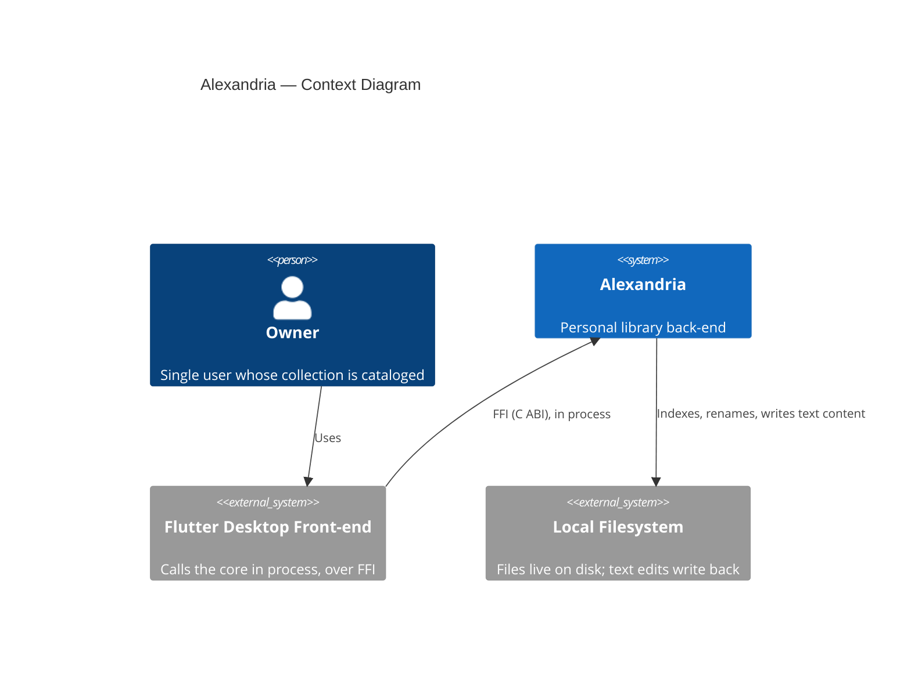
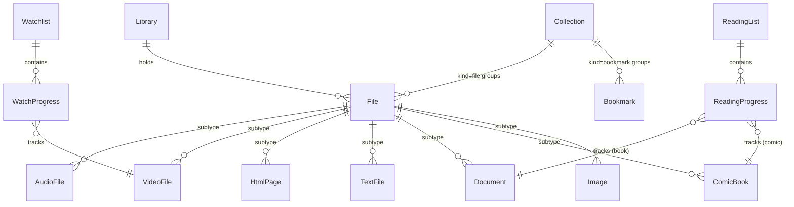

# Vision Document — Alexandria

## 1. Introduction

### 1.1 Purpose

This document establishes the **why and what, at altitude** for Alexandria — a
personal library manager back-end that indexes, organizes, and surfaces the
folders a single user adds as libraries. It states the problem, the product's position, the
stakeholders, the core features, and the success criteria. It states no versions,
no FFI calls, and no field types — those live in the
[Technology Stack Document](Technology%20Stack%20Document.md) and the
[System Requirements Document](System%20Requirements%20Document.md).

### 1.2 Scope

Alexandria is a library manager. The single owner adds folders that already
live on disk as **libraries**; Alexandria indexes every file in them it can read
— movies, series, music and other audio, HTML pages, Markdown and text files,
PDFs and e-books, comic books, and images — keeps each library's folder
structure exactly as it is, and lets the owner browse that tree and read or play
what is in it. A folder that is not a library is not Alexandria's. It also lets
the owner edit metadata, rename, organize into collections, build watchlists
and reading lists to track consumption, keep browser bookmarks, and edit the
content of Markdown and text files in place. The Flutter desktop front-end
calls its operations in process, through its C ABI; there is no server and no
login, since it only runs locally, for the person at the machine. Audio is
played as files; managing music — playlists, play history, lookups — lives in
Orpheus, a separate project.

It is explicitly **out of scope** to: support multiple users or shared
libraries; perform complex media editing (video re-encoding, image
manipulation); store or duplicate file bytes; automatically remove files from
disk; or reach a catalog over a network.

Playing a file is **in scope**: Alexandria hands the local client the file's
path to open, unmodified, which is not the media editing excluded above.

### 1.3 Definitions and Acronyms

| Term | Definition |
| --- | --- |
| **Owner** | The single person at the machine, to whom all cataloged data belongs. |
| **Library** | A folder the owner added. The only way files enter the catalog: every catalogued file belongs to exactly one library, and a library is browsed as its own folder tree. |
| **Catalog** | The set of indexed file records, collections, bookmarks, watchlists, reading lists, and progress entries. |
| **Collection** | A named flat folder grouping files (kind = file) or bookmarks (kind = bookmark). |
| **Watchlist** | A named group tracking watch progress for movies and series (VideoFiles). |
| **ReadingList** | A named group tracking read progress for books (Documents) and comic books (ComicBooks). |
| **Purge-on-disk** | The explicit operation that removes a catalog record **and** the underlying file on disk. |
| **FFI** | Foreign Function Interface — the Rust core library callable directly by the Flutter desktop front-end. |

---

## 2. Problem Statement

Files accumulate across a single user's machine — movies and series,
HTML pages, Markdown and text notes, PDFs and e-books, comic books, images, and
browser bookmarks — with no unified way to browse, search, edit metadata, or
track consumption progress. Scattered files and disconnected, browser-managed
bookmarks make organization slow, lossy, and hard to automate. The owner has no
single, type-aware view of everything already on disk, and no way to track which
media they have started, finished, or intend to consume.

---

## 3. Product Position Statement

| Attribute | Description |
| --- | --- |
| **For** | A single owner of a large, growing personal media and document collection |
| **Who** | Wants to browse, organize, edit, and track progress across every file type from one place |
| **The Alexandria** | Is a fast, type-aware library back-end over files already on disk |
| **That** | Indexes thousands of files, exposes one consistent C ABI to the desktop front-end, and tracks watchlist and reading-list progress |
| **Unlike** | The operating-system file tree and separate browser-managed bookmarks, which are untyped, unsearchable as a whole, and track no consumption progress |
| **Our product** | Treats every supported file type uniformly, keeps files where they are, stores only metadata, and is called in process by the desktop front-end |

---

## 4. Stakeholders

| Stakeholder | Role | Concern |
| --- | --- | --- |
| **Owner** | Single user whose collection is cataloged | Fast browsing, accurate metadata, safe deletion, and reliable progress tracking for watchlists and reading lists |
| **Flutter desktop front-end** | First-party client, and the only one | Consistent access to every operation, in process through the C ABI |

---

## 5. High-Level Architecture

---

## 6. Core Features

| ID | Feature | Description |
| --- | --- | --- |
| **F-01** | File indexing | Scan a library's folder tree and create type-aware catalog records, in that library, for the file types it can read, recording each file's path, size, and modification time without reading its contents. Runs asynchronously without blocking reads, report their progress while they go, and can be started at a chosen priority, paused, resumed — optionally at a new priority — and cancelled. |
| **F-02** | Catalog browsing and metadata editing | List, query, view, and edit the metadata of any supported file type; edit audio, comic-book, video, document, and image metadata; search across libraries by type, collection, and library. |
| **F-03** | Renaming and lifecycle management | Rename files (which renames them on disk), soft-delete records with restore, hard-purge records, and explicitly purge a file on disk. |
| **F-04** | Text file content editing | Read Markdown and text file content and write edited content back to the file on disk. |
| **F-05** | Collections | Create, rename, and delete flat file collections and bookmark collections; add and remove items of the matching kind. |
| **F-06** | Bookmark management | Create, update, soft-delete and restore, hard-purge, and browse browser bookmarks organized in bookmark collections. |
| **F-07** | Watchlists | Create and delete watchlists, add videos, update watch progress (per episode for series), and remove videos. |
| **F-08** | Reading lists | Create and delete reading lists, add books and comic books, update read progress (per issue for comic series), and remove items. |
| **F-09** | Pluggable authentication | **Removed (the core only runs locally for the person at the machine)** |
| **F-10** | Dual-transport parity | **Removed (the core only runs locally for the person at the machine)** |
| **F-12** | Libraries | Add a folder as a library, which indexes it; browse it one level at a time in its own folder structure; re-index it; correct its root when the folder moves; rename it; pin it and mark it as a favorite; report how many libraries and files of each type the catalog holds; remove it with its catalog records, never its files. |

These `F-xx` IDs are traced to requirement ranges in
[System Requirements Document](System%20Requirements%20Document.md) §9.

---

## 7. Domain Model Overview

Each entity carries an internal primary key plus a public UUID (see
[System Requirements Document](System%20Requirements%20Document.md) §4.0). The
owner is a single implicit principal — no entity carries a per-user foreign key.
A File is referenced by its on-disk path, size, and modification time; the bytes
are never stored, and are never read to identify the file.

---

## 8. Roles Hierarchy

Alexandria has exactly one kind of actor, so no role hierarchy diagram applies.

| Role | Relationship | Permissions |
| --- | --- | --- |
| **Owner** | The single person at the machine, and the principal for all catalog data | All read and write operations across libraries, files, collections, bookmarks, watchlists, and reading lists. There is no login: the core runs in process for that person. |

---

## 9. Constraints

- The platform is **Rust**, with `#![deny(unsafe_code)]` applied project-wide; concrete versions are pinned in the [Technology Stack Document](Technology%20Stack%20Document.md).
- The relational store is **SQLite**, embedded and bundled with the desktop app; additional databases may be introduced later but SQLite is the starting point (see [Technology Stack Document](Technology%20Stack%20Document.md) §4).
- The API stores **metadata and a reference to the file on disk only** — its path, size, and modification time — never file bytes.
- The API performs **no complex media editing** — no video re-encoding, no image manipulation.
- Deletion is **two-phase**: soft delete (restorable) then hard purge after a configurable retention window; on-disk files are removed only by an explicit purge-on-disk operation.
- Indexing runs **asynchronously** and must not block read/query operations.
- The core is used **only through its C ABI**, in process, by the desktop front-end.

---

## 10. Success Criteria

- Alexandria indexes thousands of files on a personal machine without blocking the caller, and subsequent catalog reads return fast.
- The owner can find, open metadata for, rename, edit (where applicable), and organize any supported file type from a single client.
- Watchlists accurately track which movies and series the owner has watched and what remains pending, per episode for series.
- Reading lists accurately track which books and comic books the owner has read and what remains pending, per issue for comic series.
- Soft-deleted items can be restored until their retention window expires; on-disk files are removed only by an explicit, intentional command.
- The Flutter front-end reaches every operation through the core's C ABI, with no login between the owner and their catalog.
